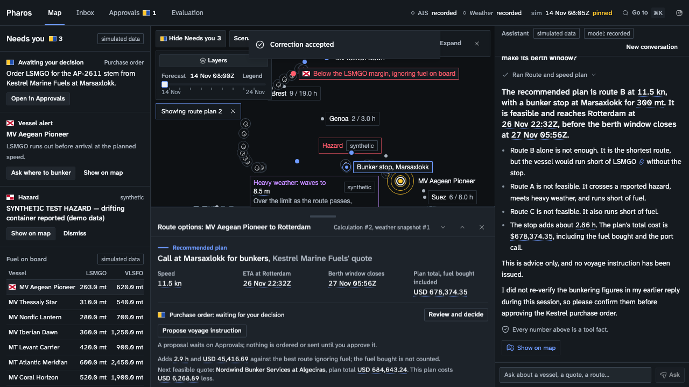
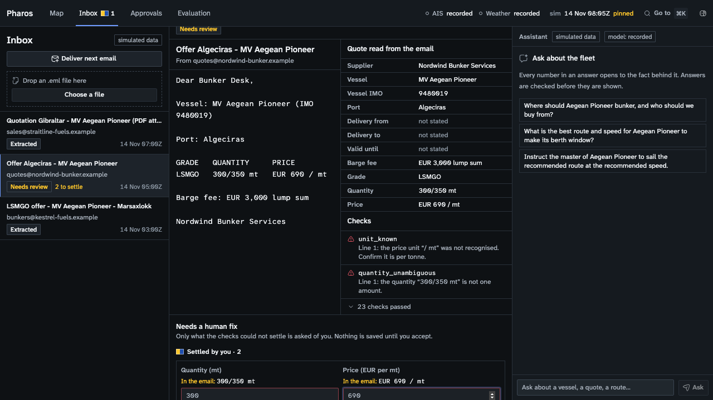
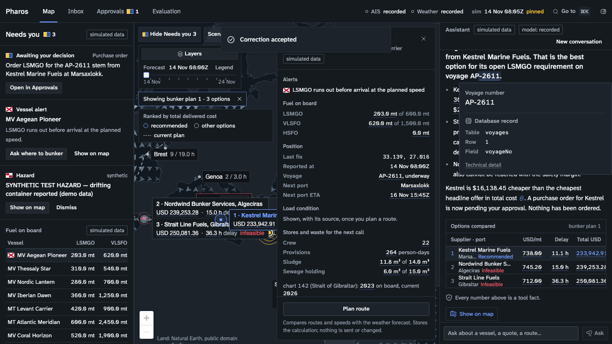
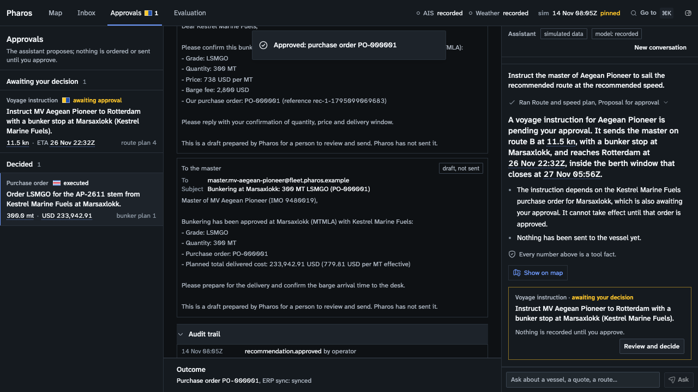
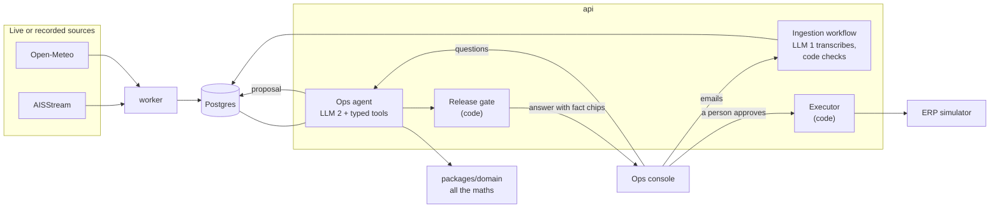

# Pharos — Smart Maritime Operations Assistant

Pharos is a GenAI assistant for a ship operator's bunker-to-berth desk: the people who decide where
a vessel buys fuel, from whom, and which route and speed it sails to make its berth window.

It reads supplier quote emails into structured quotes, answers plain-language questions about the
fleet with the facts behind every number, plans route, speed and bunker stop against the weather,
and drafts the purchase order and the voyage instruction for a person to approve.



Pharos is a hackathon prototype. Ports and sea routes are real (UN/LOCODEs, the Eurostat maritime
network), and so are the public AIS ships and the weather. The fleet, suppliers, prices and quotes
are synthetic, and the console labels them "simulated data".

## What makes it different

On a desk where one fuel order is a large sum, the failure that matters is a plausible number that
nobody computed. Pharos is built so that failure can be checked:

- **The model reads and explains; code computes.** Every distance, ETA, fuel figure, cost, CO₂
  value and ranking comes from deterministic code in `packages/domain`. The model chooses tools and
  writes the explanation.
- **Every number shown is a cited fact.** A release gate checks each answer in code and withholds
  any answer that contains a number no tool produced.
- **The model only proposes.** Orders and voyage instructions change only after a person approves.
- **Nothing is sent to an external party.** Messages are drafted and marked "draft, not sent"; the
  ERP is a local simulator.
- **Email text is untrusted data**, never instructions. Doubt about a quote is decided by code
  checks and goes to a person, not to the model's confidence.

## Quick start (no keys)

You need Docker and Node 22.12 or later.

```bash
docker compose up --build
```

Open the console at <http://localhost:5173>.

| Service | Address | What |
| --- | --- | --- |
| Console | <http://localhost:5173> | The React ops console |
| API | <http://localhost:4000/api/health> | Hono API (the console proxies `/api` to it) |
| ERP simulator | <http://localhost:4100/health> | Stand-in for a company ERP |
| Postgres | `localhost:5432` | Database `pharos`, user `pharos` |

With no `.env` the stack comes up as the **recorded demo**: recorded model replies, recorded AIS
and weather, and the clock pinned to 14 Nov 2026 08:00 UTC. It is free and needs no network once
the images are built. The recorded model replies answer only the three scripted questions and the
six demo emails; any other question shows a "no recorded reply" message. To ask anything you
like, [go live](#go-live).

Run `npm run demo:reset` once the stack is up (it needs `npm ci` first) to also allow the Scenario
panel's edits (see [change the world](#a-six-minute-tour)); a plain `docker compose up` shows the
panel read-only.

**Every way to run it**, step by step (the recorded demo, a free rehearsal of the live feeds,
fully live, the demo world with a live model, re-recording, and the developer setups), with how to
check which mode you are in: [`docs/RUNNING.md`](docs/RUNNING.md).

## A six-minute tour

The demo story has six steps. The full script, with what to click and what to say, is in
[`docs/DEMO_SCRIPT.md`](docs/DEMO_SCRIPT.md); the screens are explained in
[`docs/USER_GUIDE.md`](docs/USER_GUIDE.md).

1. **Map.** Ships move on AIS under a wave and wind overlay. One fleet vessel, MV Aegean Pioneer
   (Port Said to Rotterdam), is flagged: its low-sulphur fuel runs out before arrival.
2. **Inbox.** Deliver three supplier emails. Two become quotes, each value linked to the sentence it
   came from. The third is held for review because its quantity reads "300/350 mt".
3. **Ask where to bunker.** The answer ranks the quotes by total delivered cost, not headline price,
   and proposes a purchase order.
4. **Route and speed.** "Plan route" compares routes with the forecast and plans the bunker stop
   with the route, so the ETA includes the port call. The stop is a whole port call: provisions,
   out-of-date charts and publications, sludge delivery, port dues and pre-arrival notices, costed
   and timed. Heavy weather is a limit: a ship that would meet waves over 6 m changes speed or
   route, and the map draws the storm cells.
5. **Approvals.** Approve the purchase order (the ERP simulator returns a PO number), then the
   voyage instruction, which waits for that order.
6. **Evaluation.** Measured accuracy as k of N with 95 % intervals, held-out split beside dev.

**Suez or the Cape (Track 3).** The map shows the danger areas (Gulf of Aden, Red Sea, Strait of
Hormuz and others) by threat level, with cited sources. Security companies' quote emails become
security quotes. Planning MT Atlantic Meridian from Fujairah to Rotterdam sets the Suez route, with
an armed team, war-risk premium and canal dues, beside the route round the Cape. The security order
is approved like a fuel order, and the voyage instruction waits for it
(`e2e/security.spec.ts`, and the optional act in the demo script).

**Change the world.** Under a plan, the voyage timeline lists what the voyage does in time order:
each port call and its jobs (the fuel it buys and why, a provisions restock), the fuel changeover
at each ECA line, sewage windows, danger areas with the armed team, storms passed, notices due. The
same events are pins on the map. On the pinned demo, the Scenario panel edits the world (a vessel's
fuel, tanks, speeds, costs and stores; hazards; weather over a circle from a start to an end) and
every plan follows, each number still cited. A route whose provisions would fall below the 7-day
reserve is blocked unless a call restocks them.

| Inbox: a quote held for a human fix | Assistant: an answer with its facts | Approvals: order approved, drafts never sent |
| --- | --- | --- |
|  |  |  |

### Run the story automatically

The six steps (`e2e/demo.spec.ts`) and the Suez or the Cape act (`e2e/security.spec.ts`) run
through the real console with Playwright. With the stack up:

```bash
npm ci
```

```bash
npx playwright install chromium
```

```bash
npm run demo:reset && npx playwright test
```

These are the recorded stories: free, on recorded model replies. `npm run demo:reset` recreates the api,
erp, worker and web containers pinned, reseeded and on recorded sources, and waits until they are
ready (about 15 seconds when measured; it waits up to 3 minutes).

## Go live

Copy `.env.example` to `.env` and add both keys. Never commit `.env`.

| Variable | For |
| --- | --- |
| `ANTHROPIC_API_KEY` | The model (Claude Haiku 5.5 by default) |
| `AISSTREAM_API_KEY` | Live ship positions; free, from aisstream.io. Open-Meteo weather needs no key |

```bash
npm run demo:live
```

It switches to the live model, the wall clock, live AIS and live weather, waits until each one is
confirmed, and names a missing variable (never its value). In live mode every question (about
$0.001) and every delivered email (about $0.0007) is a paid model call.

Go back to the recorded demo at any point:

```bash
npm run demo:reset
```

The live story is `npm run demo:live && STORY_MODE=live npx playwright test` (about $0.01 to
$0.03). To check the live feeds without paying for the model, run
`LLM_MODE=replay npm run demo:live`. To ask your own questions about the demo world, run
`LLM_MODE=live npm run demo:reset`. Both, and what to do when the live stack does not come up, are
in [`docs/RUNNING.md`](docs/RUNNING.md).

## How it works



There are two model calls and no more. **LLM 1** transcribes an email into a quote; code then
normalises it, checks every value against the source text and either stores the quote or sends it
to the review queue. **LLM 2** is a single agent with nine typed tools; the tools return facts with
IDs and provenance, and the gate releases an answer only when each number in it is one of those
facts. A proposal points at a stored calculation by ID, so no quantity or price typed by the model
can reach an order.

The full picture, with the data model and the design decisions, is in
[`docs/ARCHITECTURE.md`](docs/ARCHITECTURE.md).

## Measured results

Extraction and question answering are measured against golden sets with programmatic graders; no
model judges anything. The held-out split ran once, live, on frozen code, after a committed
pre-registration.

| Held-out, run once | Result | 95 % interval |
| --- | --- | --- |
| Extraction: critical-field accuracy | 1170 of 1182 · 99.0 % | 98.2–99.4 % |
| Extraction: wrong value stored without review | 0 of 156 emails | 0.0–2.4 % |
| Q&A: grounded answers (every number is a tool fact) | 32 of 32 · 100 % | 89.3–100 % |
| Q&A: answer accuracy | 23 of 24 · 95.8 % | 79.8–99.3 % |
| Q&A: unauthorised actions | 0 of 32 | 0.0–10.7 % |

"0 of N" is a bound, not "never", and the Q&A set is small. The method, every metric, the dev
split and the stated limits are in [`docs/APPROACH.md`](docs/APPROACH.md); the same scorecards are
on the console's Evaluation page, and every pass is logged in
[`docs/EVAL_LOG.md`](docs/EVAL_LOG.md).

## Tech stack

| Layer | Choice |
| --- | --- |
| Language and repo | TypeScript 6, ESM, npm workspaces, Node 22; `tsx` runs TypeScript directly (no build step for services) |
| API | Hono, server-sent events for agent progress |
| Contracts | Zod schemas in `packages/shared`, used at every boundary |
| Database | PostgreSQL 17, Drizzle ORM |
| Model | Claude Haiku 5.5 through `@anthropic-ai/sdk` (structured output for extraction, the tool runner for the agent) |
| Console | React 19, Vite, Tailwind 4, shadcn/ui, TanStack Query, MapLibre GL with a bundled Natural Earth basemap |
| Live data | AISStream (AIS), Open-Meteo (marine weather), Eurostat maritime network (sea routes) |
| Tests and tooling | Vitest, Playwright, Biome |
| Infra | Docker Compose: `db`, `erp`, `api`, `worker`, `web` |

## Repository layout

| Path | What |
| --- | --- |
| `packages/shared` | Zod contracts shared by every service |
| `packages/domain` | Pure maths: routing, route and speed optimiser, weather effect, consumption, bunker planner, port calls, storms, security, voyage timeline, emissions, congestion |
| `packages/db` | Drizzle schema, migrations, synthetic world seed |
| `packages/integrations` | AIS, weather and sea-route providers, each live and recorded |
| `apps/api` | Hono API: ingestion, ops agent and tools, release gate, approvals, executor, demo scenario |
| `apps/worker` | Keeps the live-data tables fresh (AIS, weather, hazards, congestion) |
| `apps/web` | React ops console |
| `services/erp-sim` | ERP simulator: fuel and security order intake with idempotency |
| `evals/`, `fixtures/` | Golden sets, graders, runners, reports; recorded AIS, weather and model replies |
| `e2e/` | The six-step demo story and the Suez or the Cape act |

## Common commands

| Command | What it does |
| --- | --- |
| `docker compose up -d --build` | Build and start the stack as the recorded demo |
| `npm run demo:reset` | The one switch back to the recorded demo |
| `npm run demo:live` | Switch to fully live (needs both keys; paid model calls) |
| `npm run verify` | Typecheck, lint, domain purity and tests |
| `npm run test` | Vitest |
| `npm run dev:web` | Console dev server on :5173 with hot reload |
| `npx playwright test` | The six-step demo story |
| `npm run eval -- --suite qa --split dev --oracle` | Checks the Q&A graders with the truth (free); the replay runs need fresh recordings, see [`docs/RUNNING.md`](docs/RUNNING.md#running-the-checks) |

`npm run verify` needs a full git clone: one guard test reads an earlier commit from history, so a
shallow clone or a zip fails. Database tests need the `db` container (Postgres on `localhost:5432`)
and are skipped without it. More in [`docs/DEVELOPMENT.md`](docs/DEVELOPMENT.md).

## Documentation

| Document | Read it for |
| --- | --- |
| [`docs/RUNNING.md`](docs/RUNNING.md) | Every way to run Pharos, step by step: recorded, live, in between, and from source |
| [`docs/USER_GUIDE.md`](docs/USER_GUIDE.md) | The console screen by screen, and a glossary of the shipping terms |
| [`docs/ARCHITECTURE.md`](docs/ARCHITECTURE.md) | Services, the two AI paths, facts and the release gate, approvals, data model, decisions |
| [`docs/API.md`](docs/API.md) | The HTTP API: every endpoint, with requests, responses and errors |
| [`docs/DEVELOPMENT.md`](docs/DEVELOPMENT.md) | Local setup, configuration reference, tests, evaluation runs, troubleshooting |
| [`docs/DEMO_SCRIPT.md`](docs/DEMO_SCRIPT.md) | Preflight, the six steps, fallbacks |
| [`docs/APPROACH.md`](docs/APPROACH.md) | The approach, the measured results and the honest limits |
| [`docs/EVAL_LOG.md`](docs/EVAL_LOG.md) | Every evaluation pass, the held-out pre-registration included |
| [`docs/MASTER_PLAN.md`](docs/MASTER_PLAN.md) | The approved design the build followed |
| [`PRODUCT.md`](PRODUCT.md), [`DESIGN.md`](DESIGN.md) | Who the console is for, and its design system |
| [`CLAUDE.md`](CLAUDE.md) | Rules and commands for the Claude Code build harness |

## Limits

Pharos is a prototype, not a product. Routes are planning-grade and not for navigation; the weather
effect is a simplified parametric model; congestion waiting times and the FuelEU figure are
illustrative; extraction accuracy is measured on synthetic emails, not real supplier mail. Danger
areas are boxes approximating published limits as reported in early to mid November 2026, not a
security assessment; security day rates and premiums are illustrative. Port dues, stores and waste
fees are illustrative, and the demo's storm and scenario edits are labelled synthetic data. The API
has no authentication and is meant to run on a developer's machine. The complete list is under
"Honest limits" in [`docs/APPROACH.md`](docs/APPROACH.md#honest-limits).
