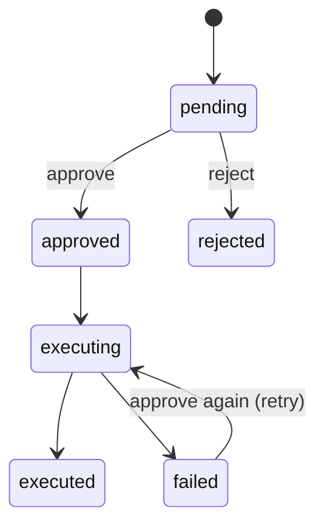

# Pharos HTTP API

The API the ops console uses. It is served by `apps/api` on port 4000; the console reaches it
through its own origin at `/api` (a proxy), so a browser never makes a cross-origin call.

Every request and response body is defined as a Zod schema in
[`packages/shared/src/api.ts`](../packages/shared/src/api.ts). That file is the contract; this page
is the map. Examples use the recorded demo.

- [Conventions](#conventions)
- [Runtime](#runtime): health, clock, data sources
- [Fleet and reference data](#fleet-and-reference-data)
- [Live map data](#live-map-data)
- [Inbox and quotes](#inbox-and-quotes)
- [Review queue](#review-queue)
- [Ask the assistant](#ask-the-assistant)
- [Plans](#plans)
- [Recommendations and approvals](#recommendations-and-approvals)
- [Model calls and evaluation](#model-calls-and-evaluation)
- [ERP simulator](#erp-simulator)

## Conventions

| Topic | Rule |
| --- | --- |
| Base URL | `http://localhost:4000` (or `http://localhost:5173` through the console's proxy) |
| Authentication | None. The API is a prototype for a developer's machine |
| Bodies | JSON, UTF-8. Times are ISO 8601 in UTC |
| IDs | Positive integers. An ID that is not one is treated as unknown (`404`) |
| Lists | `{ "items": [...] }` |
| Errors | `{ "error": "<code>", "message": "<text>" }`; some carry only `error` |
| Writes | Every `POST` must be sent as `application/json` (upload takes a raw `.eml`), even with an empty body `{}`. Anything else is `415 unsupported_media_type`. A cross-site HTML form cannot send those media types, so it cannot trigger a write |

Common error codes:

| Status | `error` | Meaning |
| --- | --- | --- |
| 400 | `invalid_request` | The body or a query parameter failed validation; `message` says which field |
| 404 | `not_found` | No such item |
| 409 | varies | The request is valid but not allowed in the current state |
| 415 | `unsupported_media_type` | Wrong `Content-Type` on a write |

## Runtime

### `GET /api/health`

```bash
curl http://localhost:4000/api/health
```

```json
{
  "status": "ok",
  "llmMode": "replay",
  "db": "up",
  "extractModel": "claude-haiku-5-5",
  "agentModel": "claude-haiku-5-5"
}
```

`status` is `degraded` and `db` is `down` when Postgres cannot be reached. `llmMode` is `live`,
`record` or `replay`.

### `GET /api/clock`

The world's anchor and the clock every request reads. `pinned` is true in the recorded demo, where
`now` is frozen at anchor + 5 minutes.

```json
{ "anchor": "2026-11-14T08:00:00.000Z", "now": "2026-11-14T08:05:00.000Z", "pinned": true }
```

`503 no_world` before a world is seeded.

### `GET /api/sources`

Which mode each live source is in. The console's AIS and Weather badges read this.

```json
{
  "items": [
    { "source": "ais", "mode": "recorded", "detail": "recorded fixtures loaded at 2026-11-14T08:00:00.000Z", "updatedAt": "2026-11-14T08:05:00.000Z" },
    { "source": "weather", "mode": "recorded", "detail": "recorded fixtures loaded at 2026-11-14T08:00:00.000Z", "updatedAt": "2026-11-14T08:05:00.000Z" }
  ]
}
```

## Fleet and reference data

Read-only views. Each list has a matching `GET …/:id` that returns one item with more detail, or
`404 not_found`.

| Endpoint | Returns |
| --- | --- |
| `GET /api/vessels` | The fleet: `id`, `name`, `imo`, `mmsi`, `shipType`, `position`, `positionAt`, `voyageId`, `robMt` (fuel on board per grade), `alerts` |
| `GET /api/vessels/:id` | The same, plus `dwt`, `tankCapacityMt`, `consumptionCurve`, `fuelTrack` (fuel on board along the rest of the current plan) and `facts` (the facts behind the panel's readouts) |
| `GET /api/voyages` | Voyages: `voyageNo`, vessel, status, origin and destination ports, `plannedSpeedKn`, `nextEta` |
| `GET /api/voyages/:id` | The same, plus `portCalls`, `plannedTrack`, `legs`, and `instruction`: the voyage instruction in force, or `null` |
| `GET /api/ports` | Ports: `id`, `name`, `unlocode`, `position`, `isEu` |

```bash
curl http://localhost:4000/api/vessels
```

## Live map data

What the worker keeps fresh. All read-only.

| Endpoint | Returns |
| --- | --- |
| `GET /api/traffic` | The latest AIS position per ship, newest first, at most 2000: `mmsi`, `name`, `shipType`, `lat`, `lon`, `sogKn`, `cogDeg`, `navStatus`, `destination`, `draughtM`, `updatedAt` |
| `GET /api/hazards` | Active navigational hazards with their keep-out radius: `id`, `kind`, `source`, `label`, `lat`, `lon`, `observedAt`, `zoneRadiusNm` |
| `GET /api/congestion` | The latest observation per port: `anchoredCount`, `waitingHours`, `observedAt`, `source` (`seed` or `ais`) |
| `GET /api/weather?step=N` | One forecast step of the latest weather snapshot |

AIS ship names, destinations and hazard labels are untrusted text from third parties. Render them
as text only.

### `GET /api/weather`

`step` is a whole number from 0 (the default) to `steps - 1`. Each point carries wave height and
direction, wind speed and direction for that step.

```json
{
  "snapshotId": 1,
  "source": "open-meteo-recorded",
  "forecastStart": "2026-11-14T08:00:00.000Z",
  "fetchedAt": "2026-11-14T08:05:00.000Z",
  "startAt": "2026-11-14T08:00:00.000Z",
  "stepHours": 3,
  "steps": 80,
  "step": 0,
  "validAt": "2026-11-14T08:00:00.000Z",
  "stepTimes": ["2026-11-14T08:00:00.000Z", "…"],
  "heavyWeatherWaveM": 6,
  "points": [
    { "lat": 36, "lon": 20, "waveHeightM": 1, "waveDirDeg": 214, "windSpeedKn": 2.6, "windDirDeg": 36 },
    "…"
  ]
}
```

`heavyWeatherWaveM` is the planning limit on wave height; the map draws heavier seas as storm.
When the demo scenario has weather areas, their points carry the areas' values at every step,
are marked synthetic, and `source` ends in `+ scenario areas`.

`404 not_found` when there is no snapshot yet; `400 invalid_request` for a step out of range.

## Inbox and quotes

Emails enter through two routes. Both store the document, answer `202` at once and extract in the
background; poll `GET /api/inbox/:id` until `extractionStatus` leaves `pending`.

### `POST /api/inbox/upload`

The body is the raw `.eml` file, sent as `message/rfc822` or `application/octet-stream`. At most
10 MB.

```bash
curl -X POST http://localhost:4000/api/inbox/upload \
  -H "Content-Type: message/rfc822" \
  --data-binary @fixtures/demo-inbox/01-kestrel-marsaxlokk.eml
```

```json
{ "documentId": 1, "duplicate": false }
```

`duplicate` is true when the same bytes were stored before; no second extraction runs.

| Status | `error` | When |
| --- | --- | --- |
| 400 | `invalid_email` | The bytes do not parse as an email |
| 413 | `payload_too_large` | Over 10 MB |

### `POST /api/inbox/deliver-next`

Delivers the next demo email from `fixtures/demo-inbox/`, in file-name order.

```bash
curl -X POST http://localhost:4000/api/inbox/deliver-next -H "Content-Type: application/json" -d '{}'
```

```json
{ "documentId": 2, "duplicate": false, "remaining": 1 }
```

`409 inbox_empty` when every demo email has been delivered.

### `GET /api/inbox` and `GET /api/inbox/:id`

The list gives `documentId`, `sender`, `subject`, `receivedAt`, `kind` and `extractionStatus`. One
item adds the body text, the extraction (each value with the `evidence` sentence it came from), the
result of every check, and any error.

`extractionStatus` is one of:

| Status | Meaning |
| --- | --- |
| `pending` | Extraction is running |
| `extracted` | Every check passed; the quote is stored |
| `needs_review` | A check failed; it waits in the review queue |
| `accepted` | A person corrected and accepted it; the quote is stored |
| `not_a_quote` | The email offers no quote |
| `rejected` | A person rejected it |
| `failed` | The extraction errored, was truncated or was interrupted; it can be retried |

### `GET /api/quotes` and `GET /api/quotes/:id`

Stored quotes: `id`, `supplierName`, `portName`, `currency`, `bargeFee`, `validUntil`, `status`,
`lines` (grade, quantity, price per tonne) and the `documentId` they came from.

## Review queue

Extractions waiting for a person.

| Endpoint | Does |
| --- | --- |
| `GET /api/review` | The queue: each item with its failed checks, the normalised values and the evidence |
| `GET /api/review/reference` | The vessels, ports and suppliers the correction form offers |
| `POST /api/review/:id/accept` | Stores the quote with the person's values |
| `POST /api/review/:id/reject` | Rejects the extraction |
| `POST /api/review/:id/retry` | Starts a new extraction (`202`; it is `pending`) |

`:id` is the extraction's ID.

### `POST /api/review/:id/accept`

Every field is required; the dates may be `null`.

```bash
curl -X POST http://localhost:4000/api/review/3/accept \
  -H "Content-Type: application/json" \
  -d '{
    "vesselImo": "9480019",
    "portUnlocode": "ESALG",
    "supplierId": 2,
    "currency": "EUR",
    "validUntil": null,
    "deliveryFrom": null,
    "deliveryTo": null,
    "bargeFee": 3000,
    "lines": [{ "grade": "LSMGO", "qtyMt": 300, "pricePerMt": 690 }]
  }'
```

```json
{ "extractionId": 3, "status": "accepted", "quoteId": 3 }
```

Take the vessel, port and supplier values from `GET /api/review/reference`.

| Status | `error` | When |
| --- | --- | --- |
| 400 | `invalid_request` | The body failed validation |
| 404 | `not_found` | No such extraction |
| 409 | `conflict` | The extraction cannot be decided in its state (only `needs_review` or `failed` can be accepted or rejected; only `failed` can be retried), or a newer extraction replaced it |
| 422 | `unprocessable` | The IMO, UN/LOCODE or supplier ID names nothing in the world |

## Ask the assistant

One question to the ops agent. Both routes take the same body and run the same agent; the stream
adds progress events while the tools run.

```json
{ "question": "Where should Aegean Pioneer bunker, and who should we buy from?", "conversationId": null }
```

`question` is 1 to 2000 characters. `conversationId` is `null` (or left out) to start a
conversation, or the ID from an earlier response to continue one.

### `POST /api/ask`

```bash
curl -X POST http://localhost:4000/api/ask \
  -H "Content-Type: application/json" \
  -d '{"question":"Where should Aegean Pioneer bunker, and who should we buy from?"}'
```

The response (`AskResponse`):

| Field | Meaning |
| --- | --- |
| `conversationId`, `messageId` | Where the answer is stored |
| `answer` | The released text, with fact citations. `null` when the release gate withheld it |
| `facts` | Every fact the answer may cite: `id`, `label`, `value`, `unit`, `provenance` |
| `recommendationIds` | Proposals this answer created (pending) |
| `llmCallIds` | The model calls behind the answer (see `GET /api/llm-calls`) |
| `subjects` | The ships the answer is about: `{ "kind": "vessel", "vesselId" }` or `{ "kind": "ais", "mmsi" }` |
| `gate` | `passed`, `repaired`, `ungroundedCount`, and one entry per attempt |

The gate reports counts only. A withheld number is never returned, not even in a list of what was
withheld.

| Status | `error` | When |
| --- | --- | --- |
| 400 | `invalid_request` | The body failed validation |
| 404 | `conversation_not_found` | No conversation has that ID |
| 500 | `replay_miss` | `LLM_MODE=replay` and no recording matches this request |
| 502 | `agent_failed` | The model refused, the answer was cut off, or the agent loop failed |
| 502 | `llm_unavailable` | The model API refused or could not be reached; `status` holds its HTTP status, or `null` |

In the recorded demo only the three scripted questions, asked in order after the demo's earlier
steps, have a recording. Anything else is a `replay_miss`.

### `POST /api/ask/stream`

The same ask as server-sent events. The response is `200` with `Content-Type: text/event-stream`;
failures arrive as an `error` event, not as an HTTP status.

```bash
curl -N -X POST http://localhost:4000/api/ask/stream \
  -H "Content-Type: application/json" \
  -d '{"question":"Where should Aegean Pioneer bunker, and who should we buy from?"}'
```

| Event | Data | When |
| --- | --- | --- |
| `progress` | `{ "type": "progress", "callId", "tool", "phase", "ms" }` | Each tool call as it is `started`, `finished` or `failed`. `callId` pairs the events of one call. No input, output or text |
| `answer` | `{ "type": "answer", "response": AskResponse }` | Exactly once, after the release gate |
| `error` | `{ "type": "error", "message" }` | Instead of `answer`, when the ask failed. The message starts with `replay_miss:` or `llm_unavailable:` for those two causes |

No answer text is streamed before the gate has passed it.

## Plans

A plan is a stored calculation. An answer, a proposal and an order all read the same stored result.

### `POST /api/route-plan`

Plans route and speed without the assistant, and stores the calculation. `vessel` is a fleet
vessel's name or IMO, or a ship seen on AIS by name or 9-digit MMSI. `destination` (a port name or
UN/LOCODE) is required for a ship that is not in the fleet.

```bash
curl -X POST http://localhost:4000/api/route-plan \
  -H "Content-Type: application/json" \
  -d '{"vessel":"Aegean Pioneer"}'
```

The response holds `calculationId`, `weatherSnapshotId`, `subject`, `destination`, the candidate
routes with their points, and `result`:

| Field | Meaning |
| --- | --- |
| `options` | Each route at its best speed: distance, hours, weather delay, ETA, fuel, CO₂, fuel, ETS, FuelEU and time cost, total cost, whether it is feasible, meets the berth window or crosses a hazard |
| `baseline` | The current plan, costed the same way |
| `bestCandidateId` | The best route ignoring fuel on board |
| `savingVsBaselineUsd`, `fuelSavingVsBaselineMt` | The best route against the current plan |
| `stopPlans` | For a fleet vessel: a route through each quote's port with the fuel bought there |
| `plan` | The recommended plan: a route, or a bunker stop, with the hours and dollars a stop adds |
| `facts` | Every number above as a citable fact |
| `timeline` | The voyage timeline for the console: `events` in time order (departure, port calls with what each does, ECA changeover, sewage discharge windows, danger areas and the armed team, storms passed, notices due, arrival) and their own `facts`. `plan_route_speed` returns `facts`, never this |

| Status | `error` | When |
| --- | --- | --- |
| 400 | `invalid_request` | The body is not `{ vessel, destination? }` |
| 422 | `route_plan_failed` | The vessel or port is unknown, or no route can be planned; `message` says why |

### `GET /api/route-plans/:id` and `GET /api/bunker-plans/:id`

A stored plan by its calculation ID, served as it was computed. `404 not_found` when the ID is not
a plan of that kind.

## Demo scenario

The console's Scenario panel: a presenter's direct edits to the pinned demo world. No agent tool
reaches these routes. Edits work only when `DEMO_CONTROLS=on` (set by `npm run demo:reset`), the
clock is pinned and the weather is recorded; otherwise `GET` says why (`enabled: false`,
`reason`) and every edit answers `403 forbidden`. Each edit answers with the whole view again.

| Route | Does |
| --- | --- |
| `GET /api/scenario` | `{ enabled, reason, edited, editedAt, vessels: [{ id, name, values }], hazards, weatherAreas }` |
| `PATCH /api/scenario/vessels/:id` | Any of `robMt`, `tankCapacityMt`, `consumption`, `dailyCostUsd`, `hullValueUsd`, `stores` (crew, provisions, sludge, sewage). Fuel on board goes on the vessel's latest noon report |
| `POST /api/scenario/hazards` | `{ label, lat, lon, radiusNm }`: a synthetic hazard, observed now |
| `DELETE /api/scenario/hazards/:id` | Removes a synthetic hazard (AIS hazards stay) |
| `POST /api/scenario/weather-areas` | `{ label, center, radiusNm, waveHeightM, waveDirDeg, windSpeedKn, windDirDeg }`: stationary weather over every forecast step inside the circle (directions are where it comes from) |
| `DELETE /api/scenario/weather-areas/:id` | Removes a weather area |
| `POST /api/scenario/reset` | Back to the recorded demo: reseeds as `SEED_ON_BOOT=reset` does (chats, approvals and the inbox too) and reloads the recorded sources |

A route plan reads the edited world on its next request. `404 not_found` for an unknown vessel,
hazard or area; `422 invalid` when a value is out of bounds or does not fit the vessel (fuel on
board above its tanks, minimum speed above the reference, an area holding no forecast point).

## Recommendations and approvals

A recommendation is a proposal to act: a `purchase_order` or a `voyage_instruction`. It points at a
stored plan (`calculationId`) and one of its options (`optionId`); it holds no quantity or price of
its own.



| Endpoint | Does |
| --- | --- |
| `GET /api/recommendations` | Every recommendation, with its facts, order, instruction and dependency |
| `GET /api/recommendations/:id` | One recommendation |
| `POST /api/recommendations` | A person proposes from a stored plan |
| `GET /api/recommendations/for-plan` | What a plan's option already has |
| `POST /api/recommendations/:id/approve` | Approves and executes |
| `POST /api/recommendations/:id/reject` | Rejects; final |
| `GET /api/recommendations/:id/drafts` | The drafted messages (never sent) |
| `GET /api/audit` | The audit trail |

### `POST /api/recommendations`

The same checks as the agent's `propose_action`.

```bash
curl -X POST http://localhost:4000/api/recommendations \
  -H "Content-Type: application/json" \
  -d '{"type":"purchase_order","calculationId":2,"optionId":"MTMLA-kestrel"}'
```

```json
{ "recommendationId": 2, "created": true, "status": "pending" }
```

`created` is false when the voyage already has this proposal (waiting, approved or carried out):
that one is returned, never a duplicate. `409 not_proposable` when the option cannot be proposed
(for example an infeasible option); `message` says why.

### `GET /api/recommendations/for-plan?calculationId=&optionId=`

Lets a plan screen avoid offering a second order or instruction.

```json
{
  "purchaseOrder": { "recommendationId": 2, "status": "executed" },
  "voyageInstruction": { "recommendationId": 1, "status": "executed" },
  "instructionInForce": null
}
```

`instructionInForce` is the voyage's current instruction when it belongs to a different option; a
new instruction from this plan would replace it.

### `POST /api/recommendations/:id/approve` and `…/reject`

The body names who decided and nothing else: `{}` or `{ "decidedBy": "name" }` (default
`operator`). An order's values always come from the stored calculation and quote.

```bash
curl -X POST http://localhost:4000/api/recommendations/2/approve \
  -H "Content-Type: application/json" -d '{}'
```

```json
{
  "recommendationId": 2,
  "status": "executed",
  "orderId": 3,
  "erpPoNumber": "PO-000001",
  "erpSyncStatus": "synced",
  "instructionId": null
}
```

Approving is safe to repeat: an executed recommendation returns its result again, and a `failed`
one (the ERP could not be reached) is retried with the same idempotency key. A failed push is not
an HTTP error; read `status` and `erpSyncStatus`.

| Status | `error` | When |
| --- | --- | --- |
| 404 | `not_found` | No such recommendation |
| 409 | `already_rejected` | Approving a rejected recommendation |
| 409 | `not_pending` | Rejecting one that is no longer pending |
| 409 | `dependency_unmet` | A voyage instruction with a bunker stop, before the purchase order for that stop is approved |
| 409 | `not_executable` | The stored plan or quote cannot be turned into the order or instruction; `message` says why |
| 409 | `illegal_transition` | Any other move the state machine does not allow |

### `GET /api/recommendations/:id/drafts`

The messages drafted on approval: `kind` (`supplier_confirmation` or `master_instruction`), `to`,
`subject`, `body`, `status` (always `draft`), `createdAt`. Read-only. Pharos never sends them.

### `GET /api/audit`

The latest audit events, or one recommendation's with `?recommendationId=`. Each has `kind` (for
example `recommendation.approved`), `actor`, `detail` and `at`.

## Model calls and evaluation

| Endpoint | Returns |
| --- | --- |
| `GET /api/llm-calls` | The latest 200 model calls: purpose, model, mode, tokens (input, output, cache read and write), `latencyMs`, `costUsd`, `stopReason`, `requestKey`, and the document or conversation it served |
| `GET /api/eval/summary` | The published evaluation scorecards the Evaluation page shows |

`GET /api/eval/summary` reads `evals/published/summary.json`, which only `npm run eval:publish`
writes. `404 no_published_summary` when nothing is published; `500 invalid_published_summary` when
the file cannot be read or does not validate.

## ERP simulator

A separate service (`services/erp-sim`, port 4100) that stands in for a company ERP. The executor
is its only caller. State is in memory and is lost on restart.

| Endpoint | Does |
| --- | --- |
| `GET /health` | `{ "status": "ok", "service": "erp-sim" }` |
| `POST /orders` | Takes a purchase order; needs an `Idempotency-Key` header |
| `GET /orders/:poNumber` | The stored order |

`POST /orders` body: `supplierErpCode`, `vesselImo`, `port` (UN/LOCODE), `currency`, `lines`
(`grade`, `qtyMt`, `pricePerMt`), `bargeFee`, `reference`.

| Status | Body | When |
| --- | --- | --- |
| 201 | `{ poNumber, status: "confirmed", createdAt, duplicate: false }` | A new order |
| 200 | The same, with `duplicate: true` | The same key and the same order again |
| 400 | `idempotency_key_required` or `invalid_order` | No key, or the body failed validation |
| 409 | `idempotency_conflict` | The same key with a different order |

## Also on port 4000

`GET /` on the API port serves a single static page from the early walking skeleton: deliver an
email, see the quote, ask, approve. The console on port 5173 replaced it.
