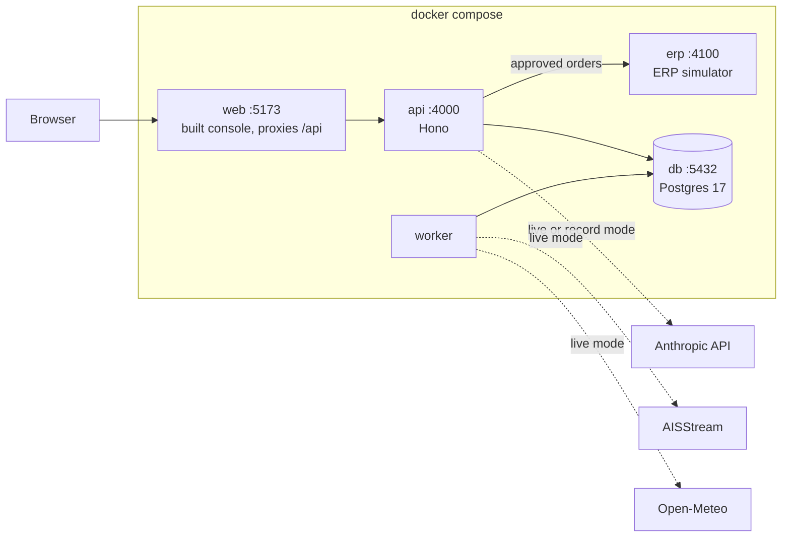
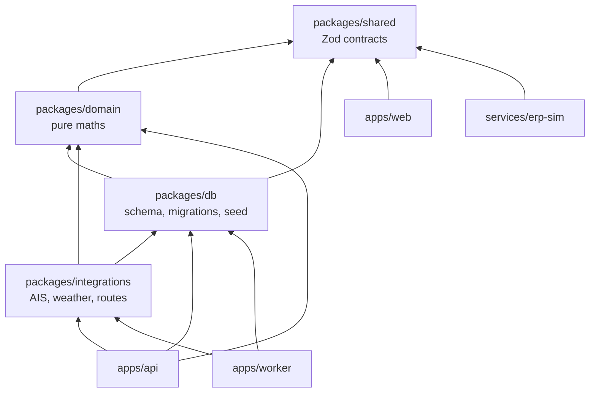
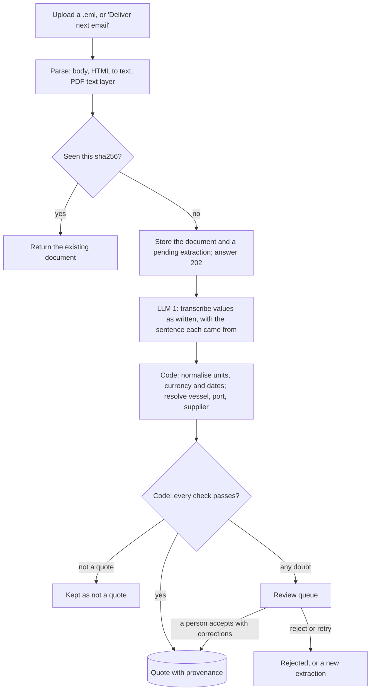
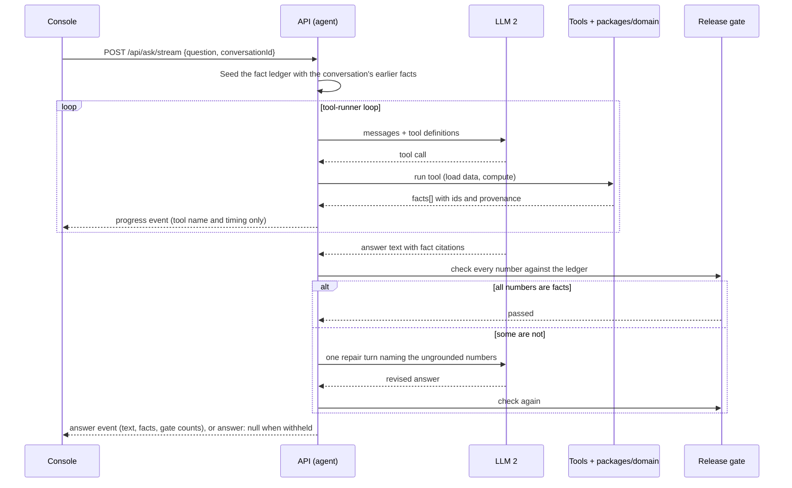
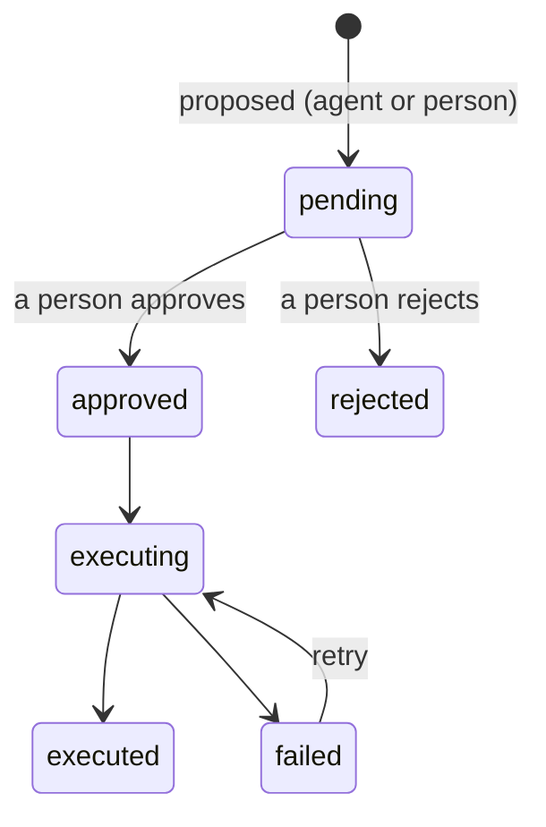

# Pharos architecture

How Pharos is built, as it stands in the code. The design it followed, with the alternatives that
were considered, is [`MASTER_PLAN.md`](MASTER_PLAN.md); where the two differ, this page describes
the code. The measured results and the limits are in [`APPROACH.md`](APPROACH.md).

## Goals

Pharos helps an operator make two decisions: where and from whom a vessel buys fuel, and which
route and speed it sails. Four goals shape the design:

1. **No number without a source.** A plausible figure nobody computed is the failure that matters.
2. **A person decides.** The assistant can propose; only an approval changes anything.
3. **Doubt is visible.** An uncertain quote goes to a person; a source that fell back to recorded
   data says so.
4. **The demo runs with the network unplugged**, free and the same every time.

## System overview

Five containers, started by Docker Compose. Every Node service runs from one image; Compose picks
the command.



| Service | Code | Role |
| --- | --- | --- |
| `web` | `apps/web` | The ops console: a static bundle served by `vite preview`. It talks to one backend, `/api`, through a same-origin proxy, and loads nothing from another origin (fonts and the basemap are bundled) |
| `api` | `apps/api` | Migrates and seeds at boot, then serves the read views, the ingestion workflow, the ops agent, approvals and the executor |
| `worker` | `apps/worker` | Writes raw observations only: AIS traffic and fleet positions, port congestion, hazards, weather snapshots, and which mode each source is in. See [`apps/worker/README.md`](../apps/worker/README.md) |
| `erp` | `services/erp-sim` | Purchase-order intake with an idempotency key; state in memory |
| `db` | Postgres 17 | The one store, and the hand-off between the worker and the API |

The dotted lines are the only calls that leave the machine, and each has a recorded mode.

### Packages



Dependencies point one way. The console depends on the contracts and on no backend code. Packages
export `./src/index.ts`; there is no build step, and `tsx` runs the TypeScript directly.

## The two AI paths

There are two model calls in the product: one that transcribes an email, one that runs the agent.
Both go through a single gateway (`apps/api/src/ai/llm.ts`).

### 1. Ingestion: a fixed workflow, no agent



The code is `apps/api/src/ingest/workflow.ts`; the checks are the pure function in `evaluate.ts`.

- **Two kinds of quote.** A fuel supplier's quote (grades, quantities, prices, barge fee), or a
  security provider's quote for an armed team (embarkation and disembarkation ports, team size, day
  rate, fixed fees, minimum days). Both go through the same workflow and the same kind of checks. A
  security quote is accepted automatically only when each value is written once; a team written
  "4/6 guards" goes to review, because a team size is never guessed.
- **The model only transcribes.** It returns each value as written (value, unit, currency) and the
  sentence it read it from, in a Zod-constrained structured output. Conversion and totals happen in
  `packages/domain` (`normalise.ts`, `dates.ts`, `price-band.ts`).
- **Status comes only from the checks.** No value the model writes can set it. The checks include:
  the evidence is found verbatim in the email and the value is in the evidence; currency, unit and
  grade are known; the quantity is one amount; dates parse and the validity has not expired; vessel,
  port and supplier resolve uniquely, and a supplier named in the email is the one the sender's
  domain belongs to; the price is within a band of the market index; the quantity fits the tank; an
  attachment has readable text.
- **The email is untrusted.** It reaches the model between `<email_document>` tags as data; any
  delimiter inside it is neutralised so the email cannot close its own block.
- **Extraction is asynchronous.** The upload answers `202` at once and the console polls. An
  extraction cut off by a restart is marked failed and waits for a retry instead of being re-run
  silently.

### 2. The ops agent: one loop, typed tools



The code is `apps/api/src/ai/agent.ts`. The agent has nine tools (`ai/tools/registry.ts`):

| Tool | What it returns |
| --- | --- |
| `list_fleet` | Every fleet vessel with IMO, type and current voyage |
| `get_vessel_status` | Fuel on board per grade, the projection along the current plan, shortfalls, next port call |
| `list_quotes` | Fuel quotes on record, by vessel, port or grade; and security providers' quotes for an armed team |
| `plan_bunkering` | Quotes ranked by total delivered cost (fuel, barge fee, deviation, delay, EU ETS, FuelEU exposure) with feasibility checks; stored as a calculation |
| `get_emissions` | CO₂ still to burn, its EU ETS cost, and the voyage's CII rating; stored as a calculation |
| `plan_route_speed` | Routes compared with the weather forecast, hazards and danger areas; for a fleet vessel, the bunker stop planned with the route as a whole port call; through a danger area, each route's and stop plan's security plan (armed team, war-risk premium, canal dues); stored as a calculation |
| `get_port_congestion` | Ships at anchor at a port and the expected wait |
| `calculate` | Arithmetic over fact IDs (never typed numbers); returns one derived fact |
| `propose_action` | The only write-capable tool: creates a *pending* purchase order, voyage instruction or security order that points at a stored calculation |

Every tool input is a strict Zod schema, so a number typed by the model has nowhere to go. A tool
only loads data and calls `packages/domain`; it computes nothing itself.

## Facts and the release gate

A **fact** is the unit of trust. Every tool returns facts, and every number a user sees is one.

```json
{
  "id": "f_plan_route_speed_2_plan.optionId",
  "label": "MV Aegean Pioneer: recommended plan",
  "value": "MTMLA-kestrel",
  "unit": null,
  "provenance": {
    "source": "calculation",
    "calculationId": 2,
    "calculator": "route_speed",
    "path": "plan.optionId"
  }
}
```

The answer cites the fact by its `id`; the console turns each citation into a chip that opens the
source.

Provenance is one of six sources (`packages/shared/src/facts.ts`):

| Source | Points at |
| --- | --- |
| `db` | A table, row and field |
| `calculation` | A stored calculation and a path into its outputs |
| `document` | An email, its extraction, the field and the evidence sentence |
| `ais` | A ship's MMSI and the time of the position |
| `weather` | A weather snapshot and its model run |
| `derived` | A `calculate` operation and its operand facts |

The **fact ledger** is every fact the tools returned in the conversation, earlier turns included
(read back from the stored tool messages, never rebuilt). The **release gate**
(`ai/release-gate.ts`) is code that reads the answer and decides whether it may be shown:

- every number must be cited, and equal the cited fact's value at the precision the answer shows;
- a currency or unit written beside the number must agree with the fact's unit, and so must its sign;
- every cited fact ID must exist in the ledger;
- a number the gate cannot read (spelled out, non-ASCII digits) is never grounded.

The gate only checks; it never edits the text. A failed answer gets one repair turn. If that fails
too, the answer is withheld: the response carries `answer: null` and how many numbers had no fact,
never the numbers themselves. Nothing the model writes is streamed before the gate has passed it.

## Proposals, approvals and the executor



- **Proposing.** A recommendation comes from the agent's `propose_action` or from a person on a
  stored plan (`POST /api/recommendations`); both run the same checks. It holds a calculation ID and
  an option ID, no quantities or prices. A voyage that already has the proposal gets that one back,
  never a duplicate.
- **Approving.** Only `POST /api/recommendations/:id/approve` moves it on. Every status change goes
  through one pure state machine (`approvals/state.ts`); an illegal move is a `409`.
- **Executing** (`executor/execute.ts`), the only code that writes orders or instructions:
  - A **purchase order** takes its quantity from the stored plan option, and price, currency and
    barge fee from the quote that option points at. It is written once per recommendation and
    pushed to the ERP after the commit with an idempotency key, so a retry after an outage cannot
    create a second order. If the ERP cannot be reached, the order is kept, marked not synced, and
    the recommendation is `failed`; approving it again retries with the same key.
  - A **security order** takes the team days from the approved route option's or stop plan's
    security plan, and the day rate, fixed fees and currency from the security quote it chose. It goes to the ERP as
    one service line (`security_team`), with the same idempotency and retry rules.
  - A **voyage instruction** records the approved route, speed, ETA and bunker stop from the stored
    route calculation. It makes no external call. It waits for each order its plan needs
    (`approvals/dependency.ts`): the purchase order for its bunker stop's quote, and the security
    order for the team its route or stop plan needs. Until each is approved, approving the
    instruction is refused (`dependency_unmet`).
- **Drafts and audit.** Approval drafts the messages a person would send: the supplier's
  confirmation, the security provider's confirmation, the master's instruction and, for a plan
  with a port call, the port agent's request (provisions, charts by number and edition, sludge to
  deliver) and the list of pre-arrival notices for the agent to file, each with its due time. They are stored as drafts and never
  sent. Every step writes an audit event.

## Deterministic maths

`packages/domain` is pure: no network, no model SDK, no `process.env`, no hidden clock or
randomness. The clock and the weather snapshot come in as inputs, so the same inputs give the same
bytes out. `npm run check:purity` (part of `npm run verify`, and a hook on every edit) enforces it.

| Module | Computes |
| --- | --- |
| `route-graph.ts` | Sea-route search over the Eurostat network: Dijkstra plus a penalty search for distinct alternatives |
| `route-optimiser.ts`, `track.ts` | One speed per route, searched exhaustively over the vessel's speed range against the forecast |
| `weather-effect.ts` | Speed loss and extra consumption from waves, wind and current (a simplified parametric model) |
| `consumption.ts`, `load.ts` | Cubic-law consumption, scaled by how laden the ship is |
| `fob.ts`, `track-fuel.ts` | Fuel on board along the plan, per grade, with an optional bunker stop |
| `bunker-planner.ts` | Quotes ranked by total cost of ownership; infeasible options kept and ranked last |
| `stop-plan.ts`, `bunker-stop.ts` | A route through a bunker port: the stop's timeline, cost and feasibility |
| `port-call.ts` | What a call has to do: provisions under the 7-day reserve, sludge over 90 % of its tank, sewage, charts and publications out of date for the areas ahead; whether the port can do it, what it costs and how long it takes, and the notices due before arrival |
| `storms.ts` | The heavy-weather limit (waves over 6 m where and when the ship is there) and the storm cells a detour goes round |
| `security.ts`, `areas.ts` | Where a route crosses a danger area and for how long; the security plan: armed team, war-risk premium, canal dues, convoy wait |
| `timeline.ts`, `coast.ts` | The voyage timeline, from the optimiser's own walk; distance from land for the sewage windows |
| `voyage.ts` | Where a vessel is along its plan at a given time, and what it burned |
| `emissions.ts`, `fueleu.ts`, `eca.ts` | CO₂, CII, EU ETS cost, FuelEU exposure, planning-grade emission-control areas |
| `congestion.ts`, `hazards.ts` | Ships at anchor and the implied wait; hazards as keep-out circles |
| `normalise.ts`, `dates.ts`, `price-band.ts` | As-written email values to structured fields; the market-band check |
| `calculate.ts` | The arithmetic behind the `calculate` tool |

A normaliser returns `null` on text it does not recognise. `null` means "needs a person", never
zero.

**When a plan is blocked.** The route optimiser ranks every option, then marks the ones that cannot
be sailed, each with its reasons: it runs short of fuel (`insufficient_fuel`), arrives with less
than the 7-day provisions reserve (`insufficient_provisions`), meets waves over the limit at the
time it is there (`heavy_weather`), crosses a hazard (`crosses_hazard`), misses the berth window
(`misses_arrive_by`), needs an armed team that no security quote covers (`security_unavailable`),
or enters an area with no transit (`avoid_area`). Blocked options are kept and ranked last, so the console
can say why. A bunker stop that buys the fuel, or restocks the provisions, can make a route
feasible; a stop whose port cannot do a job the voyage needs cannot.

A bunker stop plan through a danger area is security-planned as a route is (`stop-plan.ts`, with
the same `securityPlan`), over its own track with the call's stay included: the armed team and
its days, the war-risk premium, the canal dues and convoy wait in its total, and the same two
danger-area reasons. Security data is attached only when the voyage's planned route crosses a
danger area, so plans that cross none come out exactly as before.

## Live data and recorded modes

| Source | Live | Recorded |
| --- | --- | --- |
| AIS | AISStream WebSocket (`AIS_MODE=live`) | A capture replayed from `fixtures/recorded/ais-capture.jsonl` |
| Weather | Open-Meteo marine and forecast APIs (`WEATHER_MODE=live`) | A stored snapshot of a real forecast: the Mediterranean and north-west Europe from 15 Nov, with the lanes round Africa, the Red Sea, the Arabian Sea and the Atlantic west of Europe added from 19 Nov (`fixtures/recorded/README.md`) |
| Model | Anthropic API (`LLM_MODE=live`) | Recorded replies in `fixtures/llm-recordings/` (`LLM_MODE=replay`) |

The worker writes a `source_status` row per source, and the console shows "live" or "recorded" for
each. A live source that fails falls back to its recording and says so. Sea routes are open data
loaded once into the route graph; there is no routing API.

**Synthetic weather on the demo.** Two kinds of labelled demo weather can lie over the recorded
snapshot, and both are marked synthetic wherever they show. With `DEMO_STORM=on` (the Compose
default) the worker lays a stationary storm west of Crete (`fixtures/recorded/synthetic-storm.json`).
The Scenario panel's weather areas are stored in `scenario_weather_areas` and laid over the
forecast each time it is read, from their start to their end, past the forecast's last step too.
Neither exists in live weather or in the evaluation world.

**Model replay.** The gateway keys each request by the sha256 of its canonical JSON (method, path
and body). `replay` serves only recordings and fails loudly on a miss; `record` is replay-first and
writes only what it had to fetch; `live` always calls the API. Because the key covers the whole
request body, anything that changes it (a prompt, a tool description, the order of the tools, a
tool result) needs a new recording.

**The pinned clock.** A replay only hits if the request bytes are the same, and tool results carry
times. With `DEMO_ANCHOR` set, the world is seeded at that instant and every request reads the
clock frozen at anchor + 5 minutes (`apps/api/src/clock.ts`), so the recorded demo is reproducible.
With it empty, the clock is the wall clock. `/api/clock` reports which.

## The voyage timeline and the demo scenario

Two features exist for the console and the presenter, not for the assistant. Both were built so
that no recorded model reply changed.

- **Voyage timeline.** `packages/domain/src/timeline.ts` lists what a planned voyage does, in time
  order: departure, each port call and its jobs (the fuel it buys and why, provisions, charts,
  sludge and sewage ashore, clearance, dues), the fuel changeover at each sulphur-ECA line, where
  sewage may go overboard (beyond 12 nm from land at 4 kn or more), danger areas with the armed
  team boarding and leaving, storms passed, notices due, and arrival with the provisions left. It
  is computed from the optimiser's own walk over the chosen route, so its times agree with the
  plan. `apps/api/src/routing/timeline.ts` attaches it, with its own facts, to the route plan the
  console reads (`POST /api/route-plan`, `GET /api/route-plans/:id`). It is kept out of
  `plan_route_speed`'s output: adding it changed no request bytes, but the assistant cannot cite a
  timeline event.
- **Demo scenario.** `apps/api/src/scenario/` lets a presenter edit the pinned demo world: a fleet
  vessel's fuel on board, tanks, speeds, consumption, costs and stores; synthetic hazards; and
  weather areas. Edits are refused unless `DEMO_CONTROLS=on` (set by `npm run demo:reset`), the
  clock is pinned and the weather is recorded. No agent tool reaches these routes. A reset reseeds
  the world as a boot with `SEED_ON_BOOT=reset` does. The recorded replies cover the unedited
  demo only, so asking about an edited world needs a live model.

## Data model

One Postgres database; the schema is `packages/db/src/schema.ts`, with migrations in
`packages/db/drizzle/`.

| Group | Tables |
| --- | --- |
| Reference world | `ports` (with each port's call terms), `route_legs`, `suppliers`, `port_fuel_prices`, `reference_rates`, `nautical_items` (the chart and publication catalogue), `security_areas`, `security_providers`, `world_meta` |
| Fleet and voyages | `vessels` (with their stores: crew, provisions, sludge, sewage, charts), `voyages`, `port_calls`, `noon_reports`, `bunker_requirements`, `vessel_positions` |
| Live observations | `ais_traffic`, `nav_hazards`, `port_congestion`, `weather_snapshots`, `source_status` |
| Documents and quotes | `documents`, `extractions`, `quotes`, `quote_lines`, `security_quotes` |
| Agent | `conversations`, `messages`, `calculations`, `llm_calls` |
| Decisions | `recommendations`, `purchase_orders`, `order_lines`, `security_orders`, `voyage_instructions`, `drafted_messages`, `audit_events` |
| Demo scenario | `scenario_weather_areas` |

Two tables carry the guarantees. `calculations` stores each plan as it was computed, so an answer,
a proposal and an order all read the same stored result. `messages` stores each tool result with
its facts, and each gate attempt on the assistant message, for audit and for the evaluation.

The synthetic world is generated from `WORLD_SEED` and anchored to a point in time, so the same
seed and anchor always give the same world.

## Trust boundaries

- **Untrusted text.** Email bodies, AIS ship names and destinations, and hazard labels come from
  third parties. The model sees email text as delimited data; the console renders all of it as
  text, never as markup. Both benchmarks include prompt-injection cases.
- **Cross-site requests.** Every mutating route accepts only `application/json` (or a raw `.eml`
  for upload) and answers `415` otherwise. A cross-site HTML form cannot send those media types,
  so it cannot approve, reject or upload.
- **Offline by policy.** The built console ships a Content-Security-Policy that allows only its own
  origin.
- **Demo controls stay on the demo.** The scenario routes edit the world only on the pinned,
  recorded demo with `DEMO_CONTROLS=on`; anywhere else they answer `403`.
- **Secrets.** Keys come from the environment through a validated loader. Error messages name a
  variable, never its value, and keys are never logged.
- **No authentication.** The API trusts its caller; it is a prototype for a developer's machine.

## Key decisions and trade-offs

| Decision | Why | Cost |
| --- | --- | --- |
| Code computes every number; the model explains | A number can be traced and tested; the model cannot invent one that survives the gate | Every new kind of question needs a tool and a calculator |
| Gate before display, no streamed answer text | Nothing shown is later retracted | The answer appears at once after a wait; progress events fill the gap |
| One agent, one fixed workflow, two prompts | Fewer moving parts to measure and to record | No specialised sub-agents |
| Proposals reference a stored calculation | An order cannot contain a model-typed value | Plans must be stored before they can be proposed |
| Doubt decided by code checks, not model confidence | The reasons are named and testable | Some good quotes go to review (11 of 117 on the held-out set) |
| Recorded replies keyed by the full request | Free, deterministic tests and demo; a stale recording fails loudly | Any prompt or tool change means re-recording |
| Postgres as the only store and the worker hand-off | One thing to run and to reset | Not built for scale |
| Heavy weather as a limit, checked where and when the ship is there, plus one detour round the storm cells | Blocks only the seas a storm holds when the ship passes, so the speed choice can pass before or after it; reuses the optimiser's walk | Not a weather-routing solver: a storm that fills a whole sea is passed by timing, not routed round |
| A bunker stop planned as a whole port call | The cheapest fuel is not the cheapest call once dues, stores, waste and time alongside are counted | More inputs per port, all synthetic in the demo |
| The voyage timeline outside `plan_route_speed`'s output | No request bytes changed, so no recorded reply did | The assistant cannot cite a timeline event; only the console shows them |
| Claude Haiku 5.5 for both prompts | Lowest cost, and every published result was measured on it | Other models are unmeasured here; `EXTRACT_MODEL` and `AGENT_MODEL` switch it |

## Known limits

Routes are planning-grade; the weather model is simplified; congestion waits and FuelEU exposure
are illustrative; port-call costs, security rates and premiums are illustrative; danger areas are
dated planning boxes; private data is synthetic. The full list, with what each one means for the
numbers, is under ["Honest limits" in `APPROACH.md`](APPROACH.md#honest-limits).
