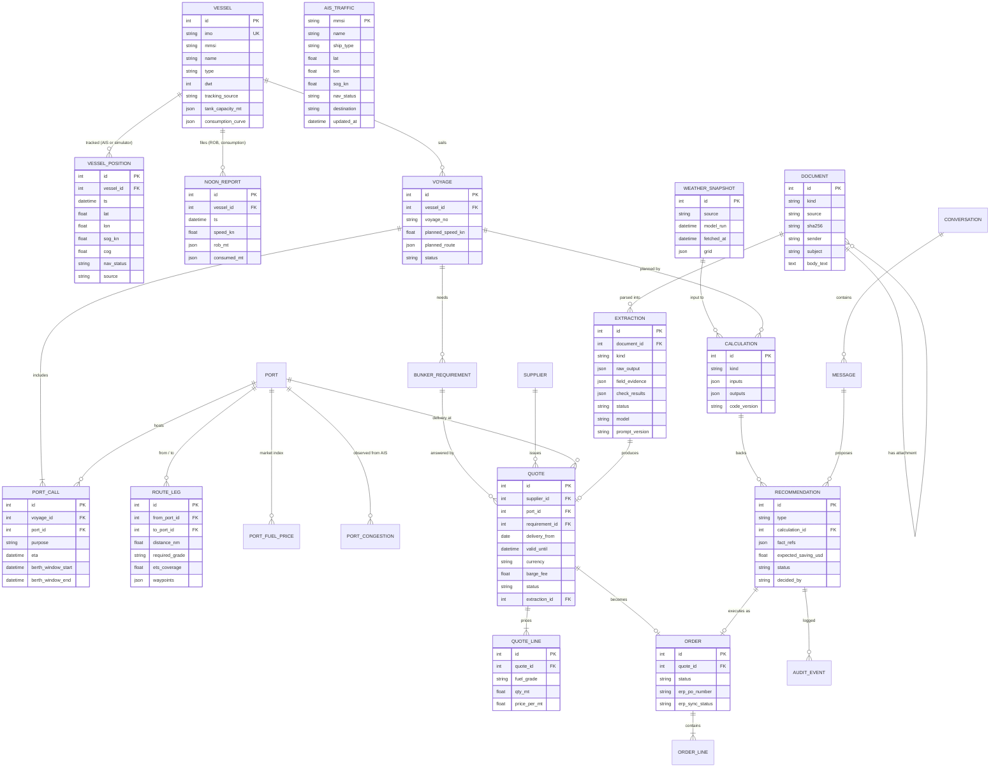
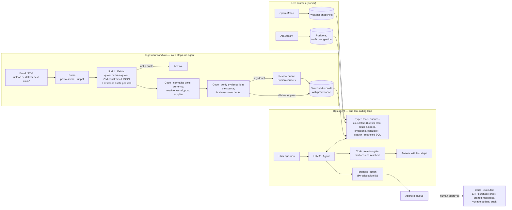

# Master Plan — Smart Maritime Operations Assistant ("Pharos", working name)

## Context

The repo is empty (one blank `README.md`, three placeholder commits). The brief — a hackathon entry — asks for a GenAI assistant over **structured maritime data** that (a) keeps a data model of vessels and operations, (b) turns emails/documents into structured records, (c) answers plain-language questions with the facts behind each answer, and (d) recommends actions for a human to approve — delivered as a working prototype, a live end-to-end demo, and an "Approach & Rationale" with measured accuracy.

**Fixed by you:** all-TypeScript; Node backend; React frontend with maps and dashboards; PostgreSQL or SQLite with a TS ORM plus Zod; a TypeScript LLM stack; Docker Compose.
**Added by you on review:** real data for realism — **live AIS, real weather-based route optimisation and an ERP hand-off** — and a hard rule that **all mathematics is done deterministically in code, never by the LLM or an external API**. A real mailbox (IMAP) is **deferred** at your request. You also asked to be told when each API key is needed: see the key checkpoints in section 12.
**Left to me (my calls, open to correction):** scenario, exact libraries, runtime AI pipeline, Claude Code harness, evaluation strategy, roadmap.

Status: approved 2026-11-14.

---

## 1. Scenario: "Bunker-to-Berth"

**One line:** Pharos watches the fleet on live AIS, reads supplier quote emails as they arrive, works out _where and from whom_ to bunker and _which route and speed_ to sail given the weather, and tees up the purchase order and voyage instruction for an operator to approve.

It joins four of the five suggested directions in one causal chain — **supply chain** (supplier emails → quotes → order), **routes** (route and speed from position, weather and schedule), **fuel & emissions** (where to refuel, consumption, CO₂/CII), **port calls** (ETA vs berth window, congestion, waiting). Maintenance is out of scope.

**Demo story (about 6 minutes):**

1. **Map** — real ships moving on **live AIS** with a **live wave/wind overlay**. The operator's managed fleet is highlighted; bulk carrier _MV Aegean Pioneer_, Port Said → Rotterdam, is flagged: the low-sulphur fuel on board will not cover the remaining emission-control-area legs with the safety margin.
2. **Inbox** — the presenter delivers three supplier emails (plain text, an HTML table in EUR, a PDF attachment); any `.eml` or PDF can also be dropped in. Each becomes a structured quote in seconds, shown beside the source with the exact sentence each value came from. One has an ambiguous quantity and is held for a one-click human fix instead of being guessed.
3. **Ask** — "Where should Aegean Pioneer bunker, and who should we buy from?" The answer compares options; every number is a clickable fact. The data is built so the cheapest headline price is _not_ the best option once barge fee, deviation, delay, weather and carbon cost are counted.
4. **Route** — "What is the best route and speed to make the berth window in this weather?" Three candidate routes appear on the map with fuel, CO₂, cost and ETA each; the recommended one is highlighted against the baseline. The same question works for **any real ship clicked on the map**.
5. **Approve** — a recommendation card → Approve → the purchase order is pushed to the **ERP** and comes back with a PO number, the supplier confirmation and the route and speed instruction to the master are drafted (never sent), and everything is in the audit log.
6. **Evaluation page** — the measured accuracy scorecard.

**Business value (illustrative industry-order figures; every parameter is seed data, not a hard-coded claim):**

- Fuel is roughly half of voyage operating cost. One stem of 500–1,000 mt at $600–750/mt is **$0.3–0.75M**.
- Spread between ports and suppliers of $10–40/mt → **$5k–$40k per stem**. A 20-vessel fleet (~$75M/yr fuel) capturing 1% saves **~$750k/yr**.
- Weather-aware routing and just-in-time arrival: 10% slower burns ~19% less fuel per mile; avoiding head seas and anchorage waiting adds to that.
- Carbon: EU ETS covers shipping emissions in full from 2026. Each tonne of fuel not burned avoids ~3.2 t CO₂ — roughly **€110–140 per tonne of fuel** on a voyage into the EU (50% coverage, as here), double between EU ports, at an allowance price of €70–90.
- Desk time: 1–2 hours of reading and re-keying quotes per stem becomes minutes, with a full audit trail.

**Domain rules the calculators respect:** the Mediterranean and the North Sea are 0.1%-sulphur zones, so each route leg carries a required fuel grade and the planner works per grade; each leg carries an ETS coverage factor (1.0 / 0.5 / 0); CO₂ factors are per grade. All are seeded parameters with sources cited in the tests.

---

## 2. Live data and integrations

Every external source sits behind a small provider interface with a **live mode and a recorded mode**, so a third-party outage cannot break the demo. The UI shows which mode each source is in.

| Integration    | Source                                                                         | What it feeds                                                                                                                                       | If it is down                                     |
| -------------- | ------------------------------------------------------------------------------ | --------------------------------------------------------------------------------------------------------------------------------------------------- | ------------------------------------------------- |
| **Live AIS**   | AISStream.io WebSocket (free API key)                                          | Live traffic on the map; position, speed, course, destination of tracked ships; anchored-vessel counts near ports → congestion and expected waiting | Replay of a recorded AIS capture; simulator       |
| **Weather**    | Open-Meteo Marine + Forecast APIs (no key): waves, swell, wind, ocean currents | Forecast sampled along each candidate route → weather effect in the route optimiser; map overlay                                                    | Stored snapshot of a real forecast                |
| **Sea routes** | Eurostat open maritime network (via `searoute-ts` / `@ssroute` graph data)     | Candidate routes that stay in navigable water                                                                                                       | Seeded waypoint table                             |
| **ERP**        | An ERP simulator service (own container, REST API) behind an adapter           | Supplier master data in; approved purchase orders out with an idempotency key; PO number back                                                       | Order kept locally, flagged "not synced", retried |

**Deferred: real mailbox (IMAP/SMTP).** Emails enter through an upload endpoint and the inbox's "deliver next email" control. The ingestion entry point takes a raw message from any source, so a mailbox poller can be added later, with its own tests, without touching the workflow.

**Public vs private data.** Positions, weather and routes are real and live. Fuel on board, quotes and orders are a company's private data, so they are simulated and labelled as such. The managed fleet is driven by a simulator that speaks the same AIS message format through the same ingestion path (which keeps the scripted demo repeatable); any managed vessel can instead be bound to a real ship's MMSI. Real ships appear under their own identity only as public traffic and for route and weather questions.

**Honest limits.** Routes are planning-grade, not for navigation. The weather effect is a simplified, documented parametric model (speed loss and extra consumption by wave height and relative direction, wind, and current), not a validated hydrodynamic one. No real ERP product is integrated; the simulator demonstrates the hand-off contract.

---

## 3. Deterministic maths — a hard guarantee

| Number                                                          | Computed by                                                                              | The model's role                     |
| --------------------------------------------------------------- | ---------------------------------------------------------------------------------------- | ------------------------------------ |
| Distances, ETAs, candidate routes, route and speed optimisation | Code (`packages/domain`: graph search + speed-profile optimiser)                         | Narrates the result                  |
| Fuel consumption, weather effect, fuel-on-board projection      | Code                                                                                     | None                                 |
| Costs, savings, currency conversion, totals, rankings           | Code                                                                                     | None                                 |
| CO₂, CII rating, ETS cost                                       | Code                                                                                     | None                                 |
| Port congestion and waiting estimate                            | Code, over AIS rows                                                                      | None                                 |
| Values in emails                                                | Model transcribes them **as written** (value + unit + currency)                          | Conversion and totals happen in code |
| Ad-hoc arithmetic in chat ("how much more is that?")            | A `calculate` tool that operates on fact IDs and returns a derived fact with its lineage | Chooses the operands only            |

External services supply **raw observations only** (positions, forecasts). No routing API, distance API or model is ever asked for a computed answer.

**How it is enforced, not just promised:**

1. `packages/domain` is pure: no network, no LLM SDK, no hidden clock or randomness (clock and weather snapshot are passed in). A dependency-boundary check runs in the hooks.
2. **Release gate:** an answer is shown only if every number in it matches a fact returned by a tool, at its displayed precision. A number the model worked out itself fails the gate.
3. **Actions carry no model-typed numbers:** `propose_action` references a stored calculation by ID; the executor reads quantities and prices from that stored calculation.
4. **Tests:** every calculator is checked against hand-computed examples; same inputs must give byte-identical outputs; the optimiser must never return a plan worse than the baseline under the same inputs.
5. **Measured:** the Q&A benchmark reports the grounded-number rate.

---

## 4. Approaches considered

| Decision           | Options weighed                                                                                                                                                        | Pick and why                                                                                                                                                                                                                      |
| ------------------ | ---------------------------------------------------------------------------------------------------------------------------------------------------------------------- | --------------------------------------------------------------------------------------------------------------------------------------------------------------------------------------------------------------------------------- |
| Runtime pipeline   | (A) one agent does everything · (B) fixed workflow for ingestion + one agent for Q&A/actions · (C) router + several specialist agents                                  | **B.** Extraction needs no autonomy — fixed steps are faster, cheaper and scoreable field by field. Q&A does need open-ended tool use, and one agent covers it. C adds latency and failure modes with nothing here that needs it. |
| Grounding Q&A      | (A) text-to-SQL only · (B) vector RAG over documents · (C) typed tools + calculators with a fact ledger, plus a restricted read-only SQL tool for off-script questions | **C.** The data is structured, so answers come from queries and deterministic maths, each returning citable fact IDs. No vector DB.                                                                                               |
| Route optimisation | (A) ask the model · (B) an external routing API · (C) our own optimiser over open route and weather data                                                               | **C.** The only option that is deterministic, explainable and testable. Candidate routes × a speed-profile optimiser, rather than a full weather-routing solver: bounded to build and easy to show on a map.                      |
| LLM layer          | Anthropic SDK direct · Vercel AI SDK · LangChain.js / LlamaIndex.TS                                                                                                    | **Anthropic SDK direct.** Two prompts and one loop do not need a framework.                                                                                                                                                       |

---

## 5. Tech stack

| Layer           | Choice                                                                                                                                      | Why this one                                                                                                                                                                             |
| --------------- | ------------------------------------------------------------------------------------------------------------------------------------------- | ---------------------------------------------------------------------------------------------------------------------------------------------------------------------------------------- |
| Repo            | npm workspaces + TS project references, Node 22                                                                                             | Already on this machine (Node 22.12, npm 11; pnpm is not installed).                                                                                                                     |
| API             | **Hono** (`@hono/node-server`, zod-validator, `streamSSE`)                                                                                  | Small, typed, built-in SSE. NestJS is ceremony for a prototype; Express has no type story.                                                                                               |
| Contracts       | **Zod** schemas in `packages/shared`                                                                                                        | One source of truth for API traffic, LLM output, tool inputs, provider payloads and eval ground truth; the frontend builds against it without depending on backend code.                 |
| Database        | **PostgreSQL 17 + Drizzle ORM** (+ drizzle-kit)                                                                                             | SQL-first, no codegen. JSONB for provenance; a **read-only role** makes the SQL tool safe by construction; doubles as the work queue between services. Tests use the same engine.        |
| LLM             | **`@anthropic-ai/sdk`**: `messages.parse` + `zodOutputFormat`, `beta.messages.toolRunner` + `betaZodTool`, native PDF input, prompt caching | Checked against the current SDK reference. Forced tool choice and `temperature` no longer exist on current models, so the design uses structured outputs and repeated-run evals.         |
| Model           | **`claude-opus-5-5`** for both prompts, effort tuned per step; one env var each                                                             | Quality first. A final accuracy/latency/cost matrix against Sonnet 5.5 and Haiku 5.5 makes a cheaper model your data-backed decision. Refusal fallbacks on in the app, off in eval runs. |
| Email           | `postal-mime` (+ `html-to-text`)                                                                                                            | Maintained successor to mailparser; typed; handles MIME parts, attachments and HTML bodies of `.eml` files.                                                                              |
| PDF             | Claude reads the PDF natively **and** `unpdf@^1.9` extracts the text layer                                                                  | The model extracts; the text layer lets code verify each quoted value is really in the document. (2.x needs Node 24, hence the pin.)                                                     |
| AIS             | `ws` client, Zod-validated messages, throttled writes                                                                                       | AISStream already delivers decoded JSON; we keep latest state for traffic and a downsampled track for tracked ships.                                                                     |
| Weather         | Plain `fetch` + Zod, stored as snapshots                                                                                                    | Each optimisation cites the exact snapshot it used, so results are reproducible.                                                                                                         |
| Routing         | Eurostat maritime network graph + our own search; `@turf/*` helpers                                                                         | Open data, our own deterministic code.                                                                                                                                                   |
| Frontend        | React 19 + Vite + Tailwind 4 + shadcn/ui, TanStack Query                                                                                    | Standard, fast, typed.                                                                                                                                                                   |
| Map             | **MapLibre GL** via `react-map-gl/maplibre`, bundled Natural Earth basemap                                                                  | No token, no tile server: the basemap works offline.                                                                                                                                     |
| Charts          | Recharts                                                                                                                                    | Fuel projection, quote and route comparison, CII gauge.                                                                                                                                  |
| Tests           | Vitest + Playwright; Biome for lint/format                                                                                                  | Biome is fast enough to run on every edit.                                                                                                                                               |
| Infra           | Docker Compose: `db`, `api`, `worker` (AIS, weather), `web`, `erp`                                                                          | One command brings up the demo. The API refuses to start without `ANTHROPIC_API_KEY` and says so.                                                                                        |
| MCP _(stretch)_ | `@modelcontextprotocol/sdk` adapter over the same tool registry                                                                             | First item to cut.                                                                                                                                                                       |

Exact versions are resolved at scaffold time and locked.

### Data model



"Stock" in the brief is fuel remaining on board per grade (from noon reports, exposed as a view). The clock is injected everywhere: the demo world is anchored to the moment the stack boots, while evals pin the clock so expected answers never drift.

---

## 6. Runtime AI pipeline — one workflow, one agent, two prompts



The worker only writes raw observations to the database. Ingestion runs as an in-process job in the API; the UI polls its status. Supplier quotes are the one document type extracted and fully evaluated.

**The rules that make it trustworthy (the "why these choices matter" part):**

1. **The model reads and explains; code computes and decides** (section 3).
2. **Every stored value has provenance.** Each extracted field carries the verbatim sentence it came from; code checks the sentence is in the source and the value is in the sentence.
3. **Doubt goes to a human, and doubt is measured by checks, not by the model's self-rated confidence:** evidence found, entities resolved uniquely, price within a band of the market index, validity not expired, quantity within tank capacity.
4. **Every answer shows its facts.** Tool results return facts with IDs (table, row, field, source document, AIS timestamp or weather snapshot). Tool progress streams live; the answer is released only after the gate passes, with one automatic repair turn, so nothing shown is later retracted.
5. **The model can only propose.** `propose_action` is the single write-capable tool and only inserts a _pending_ recommendation. Everything else happens in an executor that runs solely on a human approval, and no message is ever sent externally.
6. **Ad-hoc SQL is second-class.** Read-only role, curated views, results labelled unverified, never able to back an action.
7. **Email content is untrusted.** Passed as delimited data; the eval includes prompt-injection cases.

An `LLM_MODE=live|record|replay` switch gives free deterministic tests of everything downstream of the model and a fallback for the scripted demo. A replay miss fails loudly. Reported accuracy always comes from live runs.

**Latency targets** (confirmed by measurement in Phase 2): an email extracted within ~20 s; first progress event within ~3 s; a full answer within ~45 s; a route optimisation within ~5 s of compute. Levers if missed: effort level, fast mode, or the cheaper model the matrix supports.

---

## 7. Accuracy evaluation

The benchmark for each capability is built before that capability is tuned.

**A. Extraction benchmark (~220 emails):** ~200 generated from ground-truth JSON through varied templates (plain text, HTML tables, PDFs, EUR/USD, multi-grade, forwarded threads) plus ~20 hand-written hard cases (ambiguous quantity, expired validity, stale quote in a thread, unknown vessel, image-only PDF, injected instructions). About a fifth are not quotes at all.

- Ground truth is written first and never comes from a model. You review a sample before the first paid run. Few-shot examples come from a separate pool (leak check enforced).
- Random stratified split: **dev (~60)** for iteration and phase gates; **held-out (~160)** run **once**, at the end, for the reported numbers.
- Metrics: quote / not-a-quote precision and recall · per-field accuracy with type-aware comparison · critical-field accuracy (price, currency, quantity, grade, port, dates, vessel) · **unsafe auto-accepts** (a wrong critical value stored without review) · review-queue rate · latency and cost per email.
- Honest resolution: "k of N" with 95% intervals. Zero unsafe auto-accepts in ~130 held-out quotes supports "below about 2.5%", not "never".

**B. Q&A grounding benchmark (~45 questions, built alongside the agent):** lookups, comparisons, bunker and route decisions, unanswerable questions (must abstain), no-action-warranted cases (must not propose), injection cases. Run against pinned clock, recorded AIS and a stored weather snapshot; expected answers computed by reference code, not typed by hand. Half for iteration, half held out.

- Programmatic graders only: answer correct · **every number grounded in a tool fact** · citations valid · abstained when it should · proposed action equals the calculator's best option · **no unauthorised action**. Outcomes are graded, not tool sequences.

**C. Calculators and optimiser:** hand-computed examples; determinism (identical output for identical input); synthetic weather cases (a storm on the direct route makes the detour win only when it is actually cheaper; a following current shortens the passage); never worse than baseline.
**D. Integrations:** recorded AIS replay populates positions and congestion correctly; weather payloads parse and snapshot; ERP push is idempotent and survives a simulator outage.
**E. End-to-end:** Playwright runs the whole demo story with every source in recorded mode.

**Harness hygiene:** the runner calls the app's real entry points; API errors, truncations and refusals are recorded separately, never as wrong answers; clean database per case; served model asserted; full transcripts saved; before any paid pass the ground truth must score ~100% and an empty extractor ~0% on quote fields; hard cases repeated three times to measure run-to-run variance.

**Output:** `npm run eval` writes `evals/reports/<run>/`. The Evaluation page and `docs/APPROACH.md` show the headline numbers. Every eval runs on Claude Haiku 5.5 only (user decision 2026-11-14); there is no three-model matrix.

**Spend:** a hard **$3 cap for Phase 3's** live eval, smoke and recording spend (user decision 2026-11-14; Phase 2's spend is not counted; later phases' budgets are set by the user), tracked in `evals/spend-ledger.jsonl`; runners refuse to start when the ledger total plus the run's estimate would pass it. On Claude Haiku 5.5 one extraction costs about $0.0005–0.0015, so a 60-case dev pass is about $0.10.

---

## 8. Claude Code harness (`.claude/`)

**Subagents — 6: one per area of the codebase, plus one that never writes.**

| Agent                   | Owns                                                       | Role                                                                          |
| ----------------------- | ---------------------------------------------------------- | ----------------------------------------------------------------------------- |
| `domain-data-engineer`  | `packages/db`, `packages/domain`, seed                     | Schema, synthetic world, all calculators and the route optimiser (test-first) |
| `integrations-engineer` | `packages/integrations`, `apps/worker`, `services/erp-sim` | AIS, weather and ERP providers, each with live and recorded modes             |
| `ai-backend-engineer`   | `apps/api`                                                 | Ingestion workflow, agent, tools, prompts, release gate, SSE                  |
| `frontend-engineer`     | `apps/web`                                                 | Map with live traffic and weather, inbox, chat, approvals, eval page          |
| `eval-engineer`         | `evals/`, `fixtures/`                                      | Golden sets, graders, runners, reports — never edits prompts                  |
| `verifier`              | read-only + shell                                          | Independent gate check at every phase: runs the checks, reports evidence      |

The lead session (me) owns `packages/shared` contracts, root config, dependencies, Docker, docs and `.claude/`. Builders never grade their own work. To keep parallel work from colliding: only the lead installs dependencies, packages talk through `packages/shared` contracts and the database, and the lead lands API route stubs with fixture data before parallel work starts.

**Hooks (`.claude/settings.json`, scripts as Node `.mjs` in `.claude/hooks/`):**

| Event                      | Does                                                                                                                                                                                                                            |
| -------------------------- | ------------------------------------------------------------------------------------------------------------------------------------------------------------------------------------------------------------------------------- |
| `SessionStart`             | Prints current phase, last gate result, last scorecard headline, container status, and any API key the current phase needs that is not yet set                                                                                  |
| `PreToolUse` · Bash        | Blocks destructive or outward commands (deleting outside the repo, any push, volume prune, printing `.env`) and dependency installs by builder agents                                                                           |
| `PreToolUse` · Edit/Write  | Protects `.env*` and golden expected answers (unlock is deliberate and logged)                                                                                                                                                  |
| `PostToolUse` · Edit/Write | Biome on the edited file; **purity check on `packages/domain`** (no network, LLM, clock or randomness imports); schema-consistency check when a DB or Zod schema changes; records when a prompt or extraction schema changes    |
| `SubagentStop`             | Typecheck and tests for that agent's own package only                                                                                                                                                                           |
| `Stop`                     | Full `tsc -b` and tests for changed packages; replay evals when post-model code changed; if a prompt changed, requires a fresh live smoke run (a few dev cases, cents). Failures are fed back and work continues (loop-guarded) |

Plus a permissions allowlist for npm/npx/docker compose/local git so autonomous runs are not interrupted. Hooks will evolve during the build; I will tell you when I change one.

**Skills**

| Skill                                     | Use                                                                                                                  |
| ----------------------------------------- | -------------------------------------------------------------------------------------------------------------------- |
| `superpowers:writing-plans`               | Detailed task plan at the start of each phase                                                                        |
| `superpowers:test-driven-development`     | Calculators, optimiser, normalisers, state machine, graders                                                          |
| `superpowers:subagent-driven-development` | Executing each phase plan with the agents above, review between tasks                                                |
| `frontend-design`                         | Visual direction for the ops console                                                                                 |
| `pdf`                                     | Inspecting fixture PDFs and crafting the image-only hard cases                                                       |
| `skill-creator`                           | Authoring and testing the custom skills below                                                                        |
| `claude-api`                              | Reference whenever `apps/api/src/ai` is touched                                                                      |
| `mcp-builder`                             | Only if the MCP stretch item is built                                                                                |
| `webapp-testing`                          | Not installed here and upstream is Python-scripted → adapted as the custom `demo-e2e` skill in TypeScript Playwright |
| `web-artifacts-builder`, `docx`, `xlsx`   | Not used: the app is a real Vite project and no Office files are in scope                                            |

All except `webapp-testing` are already installed as plugins here; I will reference them rather than vendor copies and declare the marketplaces in project settings (exact keys checked against the Claude Code docs at scaffold time).

**Custom project skills (`.claude/skills/`) — three repeated procedures:**

- `maritime-data` — regenerate the synthetic world deterministically and validate its invariants; record and refresh the AIS capture and weather snapshot used in recorded mode.
- `eval-bench` — add a golden case correctly, run a benchmark, read the scorecard, do error analysis, follow the prompt-change protocol (dev only until the final pass), log to `docs/EVAL_LOG.md`.
- `demo-e2e` — bring up Compose, reset to a clean state, run and screenshot the demo story, re-record replays.

---

## 9. Repo layout

```
apps/api             Hono server · ingestion workflow · agent + tools · release gate · SSE
apps/worker          AIS consumer · weather refresher
apps/web             React ops console
packages/shared      Zod schemas: domain, extraction, API contracts, provider payloads, actions
packages/db          Drizzle schema, migrations, seed
packages/domain      Pure maths: routing graph + search, route & speed optimiser, weather effect,
                     consumption, bunker planner, emissions/CII/ETS, congestion, normalisers
packages/integrations AIS, weather, ERP providers (live + recorded modes)
services/erp-sim     ERP simulator (REST)
evals/ · fixtures/   golden sets, graders, runners, reports · demo inbox, AIS capture, weather snapshot
docs/                design, APPROACH.md, EVAL_LOG.md, DEMO_SCRIPT.md
.claude/             agents, hooks, skills, settings.json
docker-compose.yml · CLAUDE.md
```

---

## 10. Phased roadmap

Each phase starts with a written task plan, ends with the `verifier` gate, and is committed locally on a `build/prototype` branch. **Nothing is pushed unless you ask.** After Phase 1 three tracks run in parallel: the AI spine (2→3→4), live data and routing (5), and the console (6).

| Phase                                                                             | Builds                                                                                                                                                                                                                  | Gate (must pass to continue)                                                                                                                                                                                                                    |
| --------------------------------------------------------------------------------- | ----------------------------------------------------------------------------------------------------------------------------------------------------------------------------------------------------------------------- | ----------------------------------------------------------------------------------------------------------------------------------------------------------------------------------------------------------------------------------------------- |
| **0 · Harness & scaffold**                                                        | `.claude/`, `CLAUDE.md`, this plan saved to `docs/`, workspace config, all dependencies, Compose skeleton with `db` and `erp`                                                                                           | A deliberate type error is caught by the hooks; containers healthy; PDF text extraction works on host and in the container; API refuses to boot without a key                                                                                   |
| **1 · Contracts, data, core calculators**                                         | Zod contracts, Drizzle schema, synthetic world, consumption / bunker planner / emissions calculators, API route stubs with fixture data                                                                                 | Unit tests green; seed invariants hold; calculators match hand-computed examples; domain purity check passes                                                                                                                                    |
| **2 · Walking skeleton** — _key checkpoint: Anthropic_                            | Thinnest live path: one email delivered through the inbox → one quote record → one tool-backed answer → one approval, with a bare UI                                                                                    | Works live end to end; latency and real cost per call measured                                                                                                                                                                                  |
| **3 · Extraction, benchmark first**                                               | Fixture generator, hard cases, graders and runner; then the full workflow: normalise → verify → review queue                                                                                                            | Ground truth ≈ 100% and empty extractor ≈ 0% through the graders; you review a sample; then on **dev**: critical-field accuracy ≥ 98%, no unsafe auto-accepts                                                                                   |
| **4 · Agent, approvals, ERP hand-off**                                            | Tools + fact ledger, release gate, `calculate`, progress streaming, `propose_action`, approval state machine, executor (ERP push, drafted messages, audit); Q&A questions and graders                                   | On the dev half: grounded-number rate 100% of released answers, abstention and injection cases pass, no unauthorised actions; ERP push idempotent                                                                                               |
| **5 · Live data & route optimisation** _(parallel)_ — _key checkpoint: AISStream_ | AIS provider (live / replay / simulator), weather provider (live / snapshot), routing graph, weather-aware route & speed optimiser, port congestion; then exposed to the agent as tools with their own golden questions | Recorded AIS populates map and congestion; a live AIS smoke run receives positions; live and stored weather both parse; optimiser passes the synthetic-weather, determinism and never-worse tests; a plan for a real ship returns within budget |
| **6 · Ops console** _(parallel)_                                                  | Live traffic and weather layers, vessel panel, route comparison on the map, inbox with evidence highlighting, chat with fact chips, approvals, source-mode badges, evaluation page                                      | Playwright demo story passes with all sources recorded; visual check in the browser pane                                                                                                                                                        |
| **7 · Final measurement & demo hardening**                                        | Held-out pass (once, Haiku 5.5), fresh AIS capture and weather snapshot, replays re-recorded last, pre-built images, `README`, `APPROACH.md`, `DEMO_SCRIPT.md` with a preflight checklist               | Fresh clone → `docker compose up --build` → demo story passes in recorded mode and once fully live; final scorecard with intervals committed                                                                                                    |

Dev thresholds are gates; held-out results are reported as measured, never tuned toward.

**Cut order if time runs short** (first to go first): MCP adapter → ERP simulator (falls back to a local order export) → restricted SQL tool → AIS-based port congestion → Evaluation page (the scorecard stays as a document).
**Never cut:** quote extraction with evidence, grounded answers with deterministic maths, the approval flow, weather-aware route and speed optimisation, the live AIS map with its recorded fallback, the extraction scorecard, one-command Compose.

---

## 11. Verification (how you will know it works)

- `docker compose up --build`, open the web app, walk the six demo steps in section 1 — once with every source live, once with every source recorded.
- Drop a quote `.eml` or PDF into the inbox and watch it become a record.
- Click a real ship on the map and ask for its best route and speed.
- `npm run verify` — typecheck, lint, unit and integration tests, domain purity check.
- `npm run eval -- --suite extraction|qa --mode live` — scorecard with intervals, errors listed separately.
- `npx playwright test` — the demo story, headless, in recorded mode.

## 12. What I need from you, and what is out of scope

**Key checkpoints — I will stop and tell you at the moment each key is needed, not before:**

| When                                       | What I will ask you for                                           | What happens until then                                                                   |
| ------------------------------------------ | ----------------------------------------------------------------- | ----------------------------------------------------------------------------------------- |
| Start of **Phase 2** (walking skeleton)    | `ANTHROPIC_API_KEY` in `.env`                                     | Phases 0–1 need no key at all                                                             |
| **Phase 5**, before the live AIS smoke run | A free **AISStream.io** API key in `.env` (sign-up on their site) | AIS work proceeds on the simulator; the recorded capture is made once the key is in place |
| —                                          | Open-Meteo weather needs no key                                   | —                                                                                         |

You add keys to `.env` yourself; I never handle or print them. When a checkpoint arrives I will name the exact variable to set, pause only the work that depends on it, and carry on with everything else.

**Also needed:** Docker Desktop running; the $3 Phase 3 eval budget (agreed 2026-11-14); ten minutes to review sample golden cases in Phase 3; your submission deadline if there is one — the roadmap is ordered so that stopping after any phase still leaves something demo-able.

**Out of scope:** a real mailbox (IMAP/SMTP) — deferred, see section 2; a real ERP product; navigation-grade routing; maintenance prediction; a second extracted document type; authentication and multi-tenancy; sending email to external addresses by default; production hardening.

**Demo-day precautions (in `DEMO_SCRIPT.md`):** images pre-built, never rebuilt on stage; keys, AIS feed and weather checked in a preflight; any source can be flipped to recorded mode in one switch; recorded model replies cover the scripted questions only.

**Main risks:** scope — three integrations were added, hence the cut order; AISStream availability and coverage (recorded capture as fallback, coverage checked in Phase 0); chat latency on Opus 5.5 (measured in Phase 2); Open-Meteo's free-use terms and rate limits (checked at scaffold; snapshots keep request volume low); synthetic private data being too clean (hand-written hard set and your review).

## 13. Change log

**After your reviews:** live AIS, real weather-aware route optimisation and an ERP hand-off moved from "out of scope" into the plan (sections 2, 5, 10), each with a recorded fallback; the real mailbox (IMAP) was then deferred at your request, with ingestion kept source-agnostic so it can be added later; the deterministic-maths rule became an enforced guarantee with its own section (3), including a `calculate` tool, proposals that reference stored calculations, and a purity check on the maths package; a sixth subagent owns the integrations; key checkpoints were added (section 12) so you are told exactly when each API key is needed.

**After the independent builder review of the first draft:** the demo stem became 0.1%-sulphur fuel with grade-by-zone and ETS-coverage rules (the first draft's fuel is no longer legal in the Mediterranean); one extraction call instead of two; no auto-triggered agent runs; answers released after their fact check; phase gates on the dev set with the held-out set run once; a walking skeleton and an explicit cut order; `unpdf` pinned to 1.x.

**2026-11-14, before Phase 2 (user decision):** both prompts default to Claude Haiku 5.5 (lowest cost) instead of Opus 5.5, each switchable back by one env var; refusal fallbacks default off (Haiku has none server-side). Phase 2 adds one smoke run with the agent on Opus for comparison; the Phase 3 dev-set accuracy and Phase 4 grounding gates decide per prompt whether Haiku stays.

**2026-11-14, after Phase 2 (user decision):** the eval budget is **$3 for Phase 3** (not $150 for the build), and Claude Haiku 5.5 is the only model for extraction and for the Q&A questions in every eval; the three-model matrix is dropped. Phase 2's live spend (about $0.40) does not count against it.

**2026-11-16, Phase 7 (user decision):** the recorded fixtures of 15 Nov (AIS capture ~22:55 UTC, weather snapshot) are kept for the final measurement; recorded mode rebases them to the pinned 14 Nov clock, and a refresh would move 17 of the 65 Q&A truths and every route replay.

**2026-11-16, Phase 7 (lead ruling):** Docker Compose now defaults to the recorded, pinned demo (`LLM_MODE` replay, `DEMO_ANCHOR` 2026-11-14T08:00:00Z, recorded AIS and weather), so a fresh clone runs with no key; `npm run demo:live` is the explicit switch to live and `npm run demo:reset` the one switch back.

**2026-11-17, wave 1 after the prototype (user decision: "Plan wave 1", "Subagent-driven"):** the architecture review (`docs/ARCHITECTURE_REVIEW.md`) gave each fact one pure builder in `apps/api/src/facts/`, shared by the agent tool and the read view. The API now returns what the console used to work out itself: option names, the cited saving, vessel facts, forecast step times, ask subjects, progress call ids, and expected-zero flags. Tool registration, failure classification, the pinned clock and the seed each have one home, and `now` is required. No byte sent to the model changed, so the recorded replies and the published benchmark stand. The plan is `docs/superpowers/plans/2026-11-17-wave-1-facts-and-contracts.md`.

**2026-11-17, UI round wave 1 (user decisions: "Answer on map + PO decision", Signal hoist dark, "Re-record it, cap $0.25"):** answers that cite a plan draw that stored calculation on the map by id (`GET /api/bunker-plans/:id`, `GET /api/route-plans/:id`) instead of re-planning; the answer shows its options as a table; approvals became a queue beside one decision view with a price-versus-total comparison and a view-only margin fact; the confirm restates the order. Showing stored plans shifts the story's calculation numbering, so the demo's instruct turn was re-recorded ($0.0028, Phase 8 budget $0.25). The plan is `docs/superpowers/plans/2026-11-17-ui-round.md`; the spec is `docs/UI_REVIEW.md`.

**2026-11-17, UI round complete (user decisions: Signal hoist "dark themed and without the extra tabs"; "Just change the ui … We don't need a production ready product"):** the console moved to the Signal hoist world (Atkinson Hyperlegible Next and Mono, bundled; a dark ground; signal blue for act and recommended, yellow for needs-you, red for blocked; no green; ICS flags K, V, U, C and N always beside their word); a 48 px top bar with four screen tabs and needs-you count badges replaced the nav rail and status strip; the map gained a "Needs you" column and per-vessel fuel on board; plain wording and two-decimal currency throughout; the inbox shows flagged fields first beside their as-written text; evaluation opens with its four held-out claims; the route tray is non-modal, with a skip link and a `/` shortcut. The quantity-alternatives domain task was dropped and per-task reviews were replaced by one whole-branch pass (the user's lighter-process directive). Story 3 × PASS in replay with 0 misses; dev replays identical to the round's baseline; DESIGN.md rewritten from the built world.

**2026-11-19, Phase 9 (user decisions: "Plan for tracks 1 and 2", "Commit it, then build", lighter tests):** a bunker stop became a whole port call. Each stop plan works out what the voyage needs (provisions under a 7-day reserve, purifier sludge over 90 % of its tank, sewage, charts and publications out of date for the areas the route enters, from the user's supplier checklist of 16 Nov 2026), whether the port can do it, what it costs (dues, stores, waste fees, the EU waste fee) and how long (clearance, then bunkering, storing and waste delivery alongside), and the notices due 24 h before arrival; a needed job the port can't do makes the plan infeasible. Heavy weather became a limit: waves over 6 m at the time the ship is there make a route option or stop plan infeasible, the speed choice avoids it, and a route round the storm cells is added. The voyage instruction's execution drafts the port agent's request and the pre-arrival notices. No new agent tool or prompt change; replies re-recorded. Stores-only calls were cut. Track 3 (Suez or the Cape: canal dues, convoys, piracy areas, security escort) may follow. Heavy weather is drawn as one purple area (the grid squares over the limit), and the demo stack lays a labelled synthetic storm west of Crete (`DEMO_STORM=on`, off in the eval world) that a fleet vessel's sea routes and bunker-stop routes steer round, as round the hazards (user decision: "Yes, add it"). The spec is `docs/superpowers/specs/2026-11-19-port-call-and-storms-design.md`; the plan `docs/superpowers/plans/2026-11-19-port-call-and-storms.md`.

**2026-11-19, Track 3: security, Suez or the Cape (user decisions: "Now expand the map and start planning track 3 for the security… an approval from a quote is needed just like with fuel"; Atlantic Meridian's new voyage Fujairah to Rotterdam; quotes read from emails by the AI; Africa and the Arabian Sea; real sources; "Approve, cap $1.50"; "Yes, they're right"; "Yes, regenerate"):** the map covers Africa and the Arabian Sea and draws six danger areas from cited sources, ranked most-needed first. Each area has a JMIC level and a policy: no transit, armed team, war-risk premium, protective measures or navy escort. A route crossing them carries the hours inside, the armed team its plan picks from the valid security quotes (day rate, fixed fees, minimum days, boarding and leaving ports), the war-risk premium, canal dues and convoy wait, and a route round the Cape of Good Hope (K) is added. Extraction reads a second kind, `security_quote` (`extract-quote/v4`); the agent lists security quotes and proposes security orders (`agent-system/v6`). A voyage instruction through a guarded area waits for its security order, whose approval pushes an ERP service line and drafts the provider's confirmation (never sent). Golden set: 60 security extraction cases (30 dev, 30 held-out) and 4 Q&A security questions (2 dev, 2 held-out; the held-out ones are not run). Dev: security critical fields 234/243, unsafe 0/30; fuel unchanged (649/651); Q&A record pass 25/27, grounded 35/35, unauthorised 0/35. The comparison-06 dev key moved to 2,450 mt (user-approved); held-out keys are byte-identical. Spend $0.19 of $1.50. The plan is `docs/superpowers/plans/2026-11-19-track-3-security.md`.

**2026-11-19, Phase 11: demo controls and polish (user requests: "change characteristics of the demo", "see what actions are taken in each needed port stoppage … and during vessel routing", the route panel's scroll, the map flipping over Portugal, "pointing soft darts" for the weather; answers: a panel in the console; every en-route kind plus provisions restock, with a switch per kind; waves and wind each with a toggle):** a Scenario panel edits the pinned demo (vessels, synthetic hazards, weather areas laid over the forecast when it is read) with one reset that reseeds; the route plan carries a voyage timeline computed in `packages/domain` from the optimiser's own walk, outside `plan_route_speed`'s output (so no replay changed); the basemap is split at the antimeridian (its Eurasia ring had 360° edges the tiler filled inverted at zoom 2.5–4); the tray's body follows its snap; weather is drawn as SDF darts for waves and wind.

**2026-11-20, after Phase 11 (follow-ups):** scenario weather holds past the forecast's last step, and a route goes round it wherever it meets it; a scenario weather area has a start and an end, and the voyage timeline says when a route passes where a storm was before it started or after it ended. The console can hide the Needs you column, fold the layer switches into one Layers button, or put everything away at once (focus mode, F). Provisions are checked as fuel is: a route that arrives with less than the 7-day reserve is infeasible (`insufficient_provisions`) unless a bunker stop restocks them, and the restock is its own timeline entry; Aegean Pioneer's recorded story replies were re-recorded for it ($0.0171 ledgered; both stories pass twice in replay). An opened port call on the timeline states the fuel it buys, what it costs and why it was needed, from the stop plan's existing facts, so no tool output or recorded reply changed. A bunker stop plan through a danger area is now security-planned as a route is (team, war-risk premium, canal dues and convoy wait in its total; `security_unavailable` and `avoid_area` block it), and its voyage instruction waits for both the purchase order and the security order (user decision: "Plan their security"). No voyage in the shipped world has such a stop, so no tool output or recorded reply changed.

**Sources checked:** [AISStream documentation](https://aisstream.io/documentation) · [Open-Meteo Marine API](https://open-meteo.com/en/docs/marine-weather-api) · [searoute-ts](https://www.pkgstats.com/pkg:searoute-ts) · [@ssroute/typescript](https://www.pkgstats.com/pkg:@ssroute/typescript) · [Eurostat searoute](https://github.com/eurostat/searoute) · [Mediterranean sulphur zone (REMPEC)](https://www.rempec.org/en/news-media/rempec-news/effective-application-of-the-med-sox-emission-control-area-under-marpol-annex-vi)
