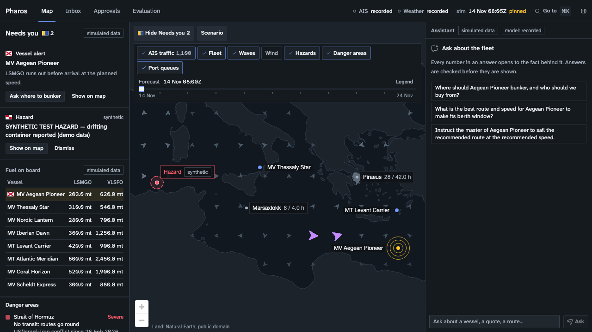
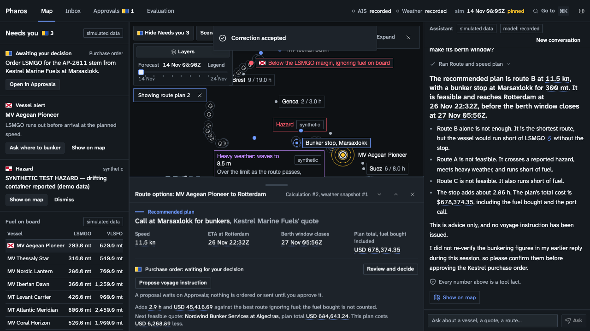
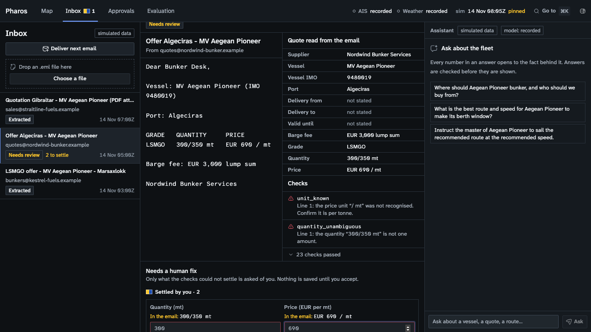
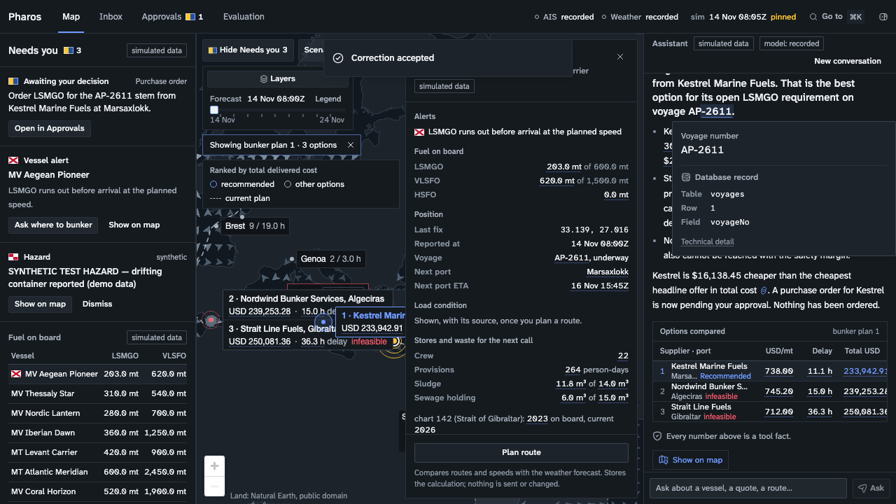
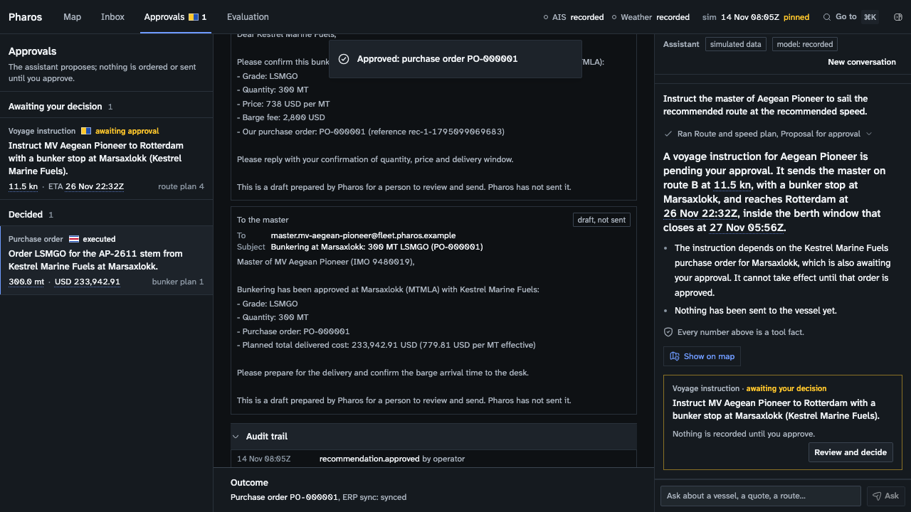

# Using the Pharos console

A guide to the ops console for the person at the bunker-to-berth desk, and for anyone watching a
demo. It explains each screen, what the assistant will and will not do, and the shipping terms the
console uses.

To start the console, see the [quick start](../README.md#quick-start-no-keys); every other way to run
it is in [`RUNNING.md`](RUNNING.md). To present the
six-minute demo, follow [`DEMO_SCRIPT.md`](DEMO_SCRIPT.md).

## Three things to know first

1. **Every number has a source.** A number in an answer or a panel is a fact chip. Open it to see
   where it came from: a database record, a stored calculation, a sentence in a supplier email, an
   AIS position or a weather snapshot.
2. **You decide.** The assistant can propose a purchase order or a voyage instruction. Nothing is
   ordered, recorded or changed until you approve it on the Approvals screen.
3. **Nothing leaves the building.** Messages to the supplier and the master are drafted for you to
   review and are marked "draft, not sent". The ERP is a local simulator.

## The top bar

| Item | What it tells you |
| --- | --- |
| **Map, Inbox, Approvals, Evaluation** | The four screens. A count beside a name is how many items there wait for you |
| **AIS** and **Weather** badges | Whether each source is `live` or `recorded` right now |
| **sim** clock | The time the console's world is at. "pinned" means the recorded demo: the clock is frozen so the demo is the same every time |
| **Go to** (Ctrl+K or Cmd+K) | Jump to a screen, a fleet vessel, a port, or any ship on the map by name or MMSI |

Labels such as "simulated data" and "synthetic" are part of the product. The fleet, its fuel, the
suppliers and the quotes are simulated company data; the public ships, the weather, the ports and
the sea routes are real.

## Map

The map is where you see the fleet and plan a voyage.

**Layers.** Switch each on or off: AIS traffic (public ships), Fleet (your vessels), Waves, Wind,
Hazards, Danger areas and Port queues (ships at anchor). Waves and wind are drawn as darts pointing
the way they travel; a dart grows and brightens as the sea or the wind gets stronger, and a wave
dart turns purple at the heavy-weather limit the routing respects (6 m). The forecast slider moves
both through the forecast; Legend shows the scale.

**Needs you.** The column on the left lists what is waiting: proposals awaiting your decision,
vessel alerts, and reported hazards. Each has a shortcut, for example "Ask where to bunker" or
"Show on map". Below it, "Fuel on board" (every fleet vessel) and "Danger areas" open from their
titles.

**Less on screen.** The top bar's switches hide the Needs you column and the assistant; the arrow at
the end of the layer switches folds them into one Layers button; focus mode (the top bar, or F)
puts all of it away at once. The console remembers the column and assistant switches in your
browser; focus mode is not remembered. Zoomed out, the map
draws every other weather dart, port queues show their figures on hover, and danger areas their
level on hover.

**A fleet vessel.** Select a vessel to open its panel: alerts, fuel on board per grade against tank
capacity, position, voyage, next port and ETA, and a curve of fuel on board along the current plan.
A point where the curve crosses the safety margin is where the vessel runs short.

**Plan route.** The button in the vessel panel compares routes and speeds against the weather
forecast and the reported hazards. The route tray then shows two answers side by side:

- the **best route ignoring fuel on board**, and where it would run short;
- the **recommended plan**: route, speed and, when fuel is short, a bunker stop at a quote's port.
  It shows the stop's arrival, waiting, weather and bunkering time, what the stop adds in hours and
  dollars, the ETA against the berth window, and how the plan compares with the next feasible quote.

**Why a route is blocked.** The route table keeps every route and says why one cannot be sailed:
it runs below the fuel margin, its provisions fall below the company reserve (7 days) before
arrival, it meets waves over the heavy-weather limit, it crosses the reported hazard, it arrives
after the berth window closes, it needs an armed security team that no valid quote covers, or it
crosses an area to avoid. A bunker stop that buys the fuel or restocks the provisions can make a
route possible again.

**Suez or the Cape.** For a voyage that could pass a danger area, each route lists the areas it
crosses and the hours inside, the armed team its plan chose and where the team boards and leaves,
and its cost lines: team, war-risk premium and canal dues. The tray sets the canal route's total
beside the route round the Cape. A bunker stop on such a voyage is planned the same way: the
recommended stop lists its own team and costs under its port call, in the plan total.

**Voyage timeline.** Under the plan, the tray lists what the voyage does, in time order: departure,
each port call with what it does there (bunkers, provisions when they run low, charts and
publications, sludge or sewage ashore, clearance, port dues; open it for the quantities and costs),
the fuel changeover at each sulphur-ECA line (it starts an hour before), where holding-tank sewage
may go overboard (more than 12 nm from land at 4 kn or more), danger areas with the armed team
boarding and leaving, the storms passed and how far off, the notices due before a call, and the
arrival with the provisions left. A switch per kind hides what you do not need; the same events are
pins on the map. Pick a row and its pin is ringed and brought into view; pick a pin and its row is.

Opened, a bunker call states the grade and amount it buys, the fuel cost and barge fee, why the
fuel was needed (what the best route without a stop was short of to keep the margin), and that
grade on board on arrival, after bunkering and at the destination, against its margin. A call
that restocks provisions says how many person-days it buys and how many days are left at the
destination. Each figure is a fact chip.

Planning stores a calculation. Nothing is sent or changed.

**Propose from the plan.** From a planned route you can propose the purchase order and the voyage
instruction yourself, without asking the assistant. A proposal is pending until you decide it on
Approvals. If the voyage already has that proposal, the console opens it instead of making a second
one, and it tells you when a new instruction would replace the one in force.

**Any ship on the map.** Select a public ship, choose a destination port and plan its route. The
fuel figures then rest on the ship's reported draught; the console says which load condition it
assumed.

Routes are planning-grade. They are not for navigation.

**Demo scenario.** On the pinned demo, the Scenario button beside Needs you opens a panel to change
the demo world: a fleet vessel's fuel on board, tanks, speeds and consumption, costs and stores; a
hazard; or weather (wave height and direction, wind speed and direction) over a circle, from a start
to an end you set (it may run past the forecast). A route that would meet it while it is on goes
round it; when a route passes where a storm was after it ended, or before it starts, the voyage
timeline says so. Type a
position or use "Pick on map"; the circle shows dashed until you add it. The top bar then says
"scenario edited", and an open route plan says it was made before the edit, with Plan again.
"Reset the demo world" puts everything back, chats, approvals and the inbox included. The
assistant's recorded replies cover the unedited demo only; to ask about an edited world, run
`LLM_MODE=live npm run demo:reset` (paid model calls).

## Inbox

The inbox turns supplier emails into quotes.

**Getting an email in.** "Deliver next email" delivers the next demo email. You can also drop a
`.eml` file onto the upload area. Extraction takes a few seconds; the row's status updates by
itself.

| Status | Meaning |
| --- | --- |
| Reading | Extraction is running |
| Extracted | Every check passed. The quote is stored and the assistant can use it |
| Needs review | At least one check failed. The quote waits for you |
| Accepted after fix | You corrected and accepted it |
| Not a quote | The email offers no quote. It is kept, and nothing is stored from it |
| Extraction failed | The extraction did not finish. You can retry it |
| Rejected | You rejected it |

**Reading a quote.** Open an email to see it beside the extracted values. Hover or focus a value
and the sentence it came from is highlighted in the email. Below the values, the checks list what
was verified: for example that the price is within a band of the market price, that the quantity
fits the vessel's tanks, and that the validity has not expired.

**Fixing a quote.** When a check fails, the review form asks only for what the checks could not
settle, and shows what the email said beside each field. In the demo, one email gives the quantity
as "300/350 mt"; Pharos does not guess which. Enter the values, choose "Accept correction" and
confirm with "Save corrected quote". Nothing is saved until you accept.

**Security quotes.** A security company's email offering an armed team becomes a security quote:
the provider, where the team boards and leaves, the team size, the day rate, fixed fees and the
minimum days charged. The same checks apply. A team written two ways, such as "4/6 guards", is
held for review; Pharos never guesses a team size.

## The assistant

The assistant sits in the panel on the right of every screen. Ask in plain language about a
vessel, a quote, a route, a port or the fleet.

**What happens when you ask.**

1. While it works, the panel names each step it runs, for example the bunker plan or the route and
   speed plan.
2. The answer appears all at once. Pharos checks it first: every number must be a fact that one of
   its tools returned. The line under the answer says the check passed.
3. Numbers in the answer are fact chips. Open one for its source, with a link to the email or the
   plan it came from.
4. "Show on map" takes you to the vessel or the plan the answer is about.

**If an answer is withheld.** When the check finds a number with no source, Pharos asks the model
once to correct the answer. If that fails too, you see that the answer was withheld and how many
numbers had no source, and none of its text. Ask again, or rephrase.

**Proposals.** Ask the assistant to decide ("where should we buy?") or to instruct the master, and
it creates a proposal and tells you so. A card links to it. Ask it only to compare or to look
something up, and it proposes nothing.

**What it can answer.** Fuel on board and where a vessel runs short; the fuel and security quotes
on record; where and from whom to bunker, ranked by total delivered cost; the best route and speed
for a berth window, with the port call, the weather and, through a danger area, the armed team,
war-risk premium and canal dues; CO₂, EU ETS cost, FuelEU exposure and the CII rating of a voyage;
how busy a port is; and arithmetic over figures it has already given ("how much more is that?").
The voyage timeline is the console's: the assistant does not cite its events.

**What it will not do.** It does not order, send or change anything. It does not act on
instructions written inside an email or an AIS message. It abstains when it has no data, rather
than estimate.

**In the recorded demo** the assistant can answer only the three suggested questions, in order.
Any other question shows "This question has no recorded reply." Use "New conversation" and pick a
suggested question, or switch to a mode with a live model: the [demo world with a live
model](RUNNING.md#4-the-pinned-demo-with-a-live-model) or [fully live](RUNNING.md#3-fully-live).

## Approvals

Every proposal waits here until you decide.

**The queue.** "Awaiting your decision" lists pending proposals; "Decided" lists the rest. Select
one to see what it would do, the facts behind it, and the plan it came from.

**Approve or reject.** Each asks you to confirm first.

- Approving a **purchase order** creates the order from the stored plan and the supplier's quote
  and pushes it to the ERP simulator, which returns a PO number.
- Approving a **security order** orders the armed team the route's plan chose, for the days it
  charges, at the security quote's rates. The card shows the team, the days charged, when it
  boards and the team cost. The ERP simulator returns an order number.
- Approving a **voyage instruction** records the route, speed, ETA and any bunker stop as the plan
  in force. It sends nothing to the vessel.
- Rejecting is final.

**Orders first, then instruction.** A voyage instruction that calls at a port to bunker depends on
the purchase order for that fuel; one whose route or bunker stop needs an armed team depends on
the security order too. Approve stays disabled, and says which order it waits for, until each is
approved.

**Drafted messages and the audit trail.** After an approval, open the proposal to read what was
drafted: the confirmation to the supplier or to the security provider, the instruction to the
master and, for a port call, the request to the port agent (provisions, the charts by number and
edition, the sludge to deliver) and the pre-arrival notices with their due times. Each is marked
"draft, not sent". The audit trail lists every step with who took it and when.

## Evaluation

This screen shows how accurate Pharos was when measured: extraction of quotes from emails, and
question answering. Each figure is a count (k of N) with a 95 % interval, never a bare percentage.
The held-out sets, which ran once, are shown beside the dev sets used during the build. Each entry
names its model, prompt version, run date and cost per item.

How the numbers were produced, and where they stop, is in [`APPROACH.md`](APPROACH.md).

## Keyboard

The console is operable by keyboard throughout, with visible focus. Ctrl+K or Cmd+K opens the
"Go to" menu from any screen. Dialogs close with Escape. Reduced-motion settings are respected.

## Glossary

| Term | Meaning |
| --- | --- |
| AIS | Automatic Identification System: the position, speed and destination that ships broadcast |
| MMSI | The nine-digit number that identifies a ship's AIS transmitter |
| IMO number | A ship's permanent seven-digit identity number |
| UN/LOCODE | The five-character code for a port, for example `NLRTM` for Rotterdam |
| Bunkering | Taking on fuel. A bunker stop is a port call to do so |
| LSMGO, VLSFO, HSFO | Fuel grades: low-sulphur marine gas oil, very-low-sulphur fuel oil, high-sulphur fuel oil |
| Fuel on board | What is left in the tanks, per grade. Also written ROB (remaining on board) |
| Safety margin | The reserve of fuel a plan must never go below |
| Noon report | The vessel's daily report of position, speed and fuel |
| Barge fee | The supplier's charge for delivering fuel by barge, on top of the price per tonne |
| Total delivered cost | Fuel, barge fee, the cost of deviating and of delay, and carbon costs. Pharos ranks quotes by this, not by headline price |
| Berth window | The time by which the vessel must arrive to keep its berth |
| ETA | Estimated time of arrival |
| ECA | Emission control area: waters where only low-sulphur fuel may be burned |
| EU ETS | The EU Emissions Trading System: a cost per tonne of CO₂ on voyages to, from and within the EU |
| FuelEU Maritime | An EU rule that penalises fuel above a greenhouse-gas intensity limit. Pharos shows it as an exposure: the penalty if nothing offsets it |
| CII | Carbon Intensity Indicator: a yearly rating, A to E, of a ship's CO₂ per unit of transport work |
| Laden, ballast | Carrying cargo, or sailing empty. A ship in ballast burns less at the same speed |
| Port call | Everything a stop does: clearance, bunkering, provisions, charts and publications, sludge and sewage ashore, port dues and the notices due before arrival |
| Port agent | The local company that arranges a port call for the ship. Pharos drafts the request to them |
| Pre-arrival notice | Information a port needs before a ship arrives, by a due time (agent appointment, security information, the EU waste notification) |
| Provisions reserve | The days of food and stores the crew must still have on arrival. Pharos uses a 7-day company reserve |
| Sludge | Oily residue from the fuel purifiers, kept in a tank and delivered ashore |
| Heavy-weather limit | The wave height a route must not meet where and when the ship is there. Pharos uses 6 m |
| Danger area | Waters with a security threat. Pharos shows the JMIC threat level and what the area asks of a ship |
| JMIC | Joint Maritime Information Center: publishes threat levels for the Red Sea, Gulf of Aden and nearby waters |
| Listed area | Waters the London insurance market's Joint War Committee lists as high risk; transits pay a war-risk premium |
| Armed team | Private armed security guards who board for a danger area and leave after it |
| War-risk premium | An extra insurance charge for a transit of a listed area, a share of the hull value |
| Canal dues | The toll for a canal transit, such as Suez |
| kn, nm, mt | Knots, nautical miles, metric tonnes |
